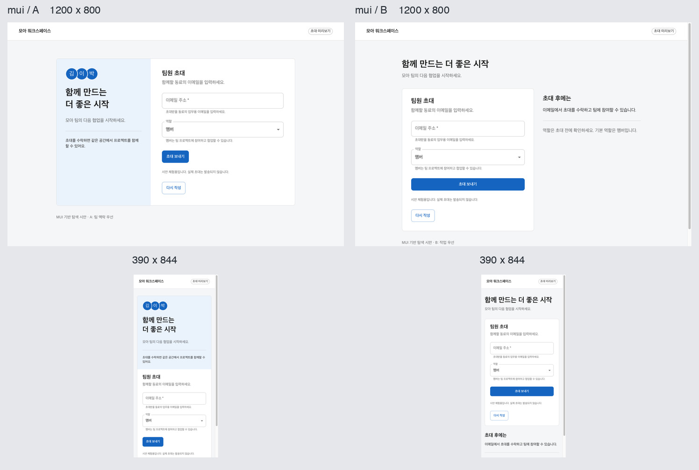
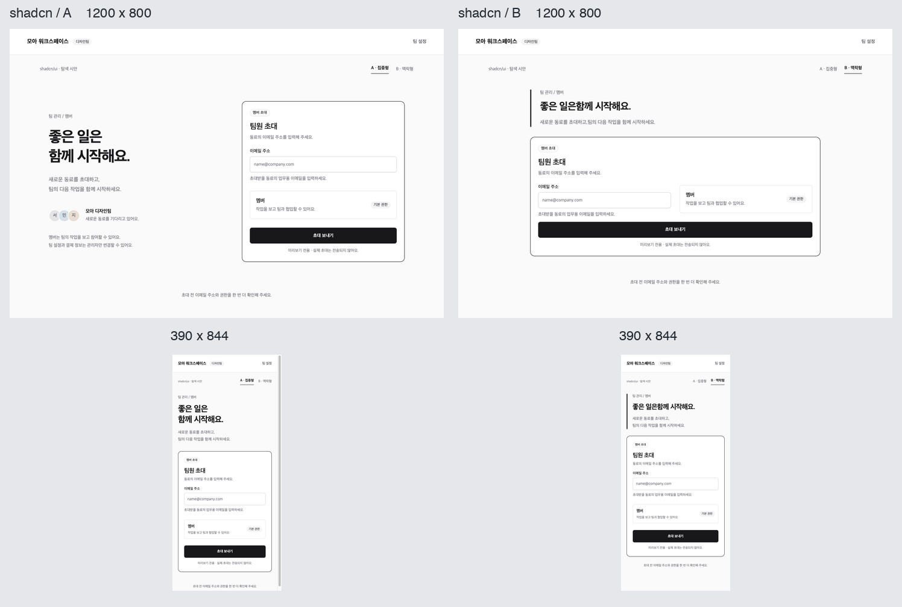
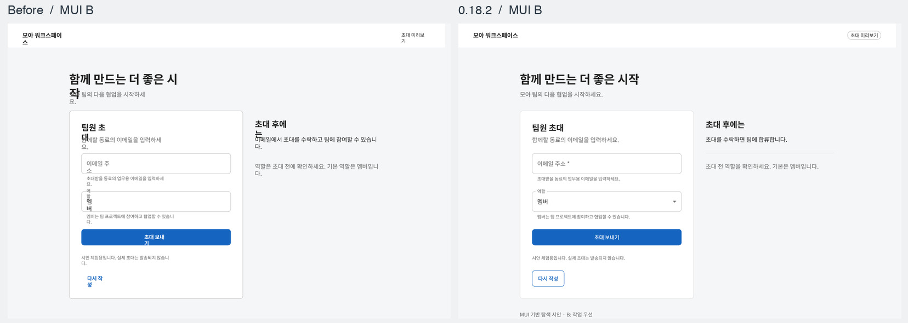
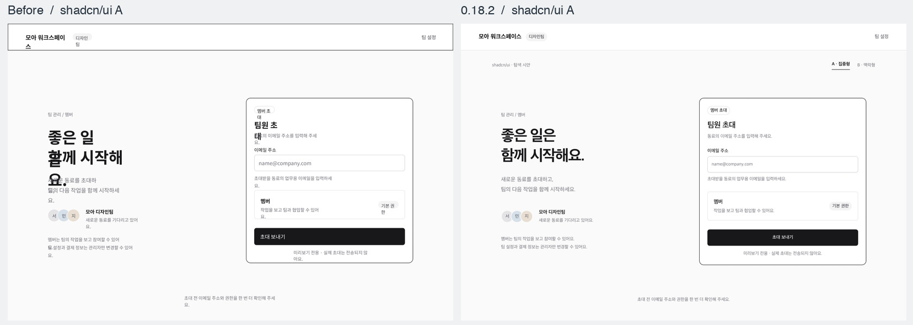

# 같은 팀원 초대 화면을 두 디자인 시스템으로 비교

한국어 이메일 초대 화면을 shadcn/ui와 MUI로 각각 두 안씩 만들었습니다. 기본 역할은 멤버이고 잘못된 이메일, 제출 중, 완료, 다시 입력 상태를 포함합니다. 전송은 로컬에서 모의 처리했습니다. 아래 이미지는 1200×800과 390×844 브라우저 캡처를 같은 비율로 줄여 나란히 배치한 것입니다.

## 이번 기획의 채택안 · MUI B

팀 관리자가 휴대폰에서 이메일과 역할을 확인하고 보내는 작업에 가장 잘 맞았습니다. MUI B는 입력과 역할 선택을 먼저 보여 주고 초대 뒤의 설명을 아래로 보냅니다. 390×844에서 전송 버튼 하단이 화면 위에서 561px이어서 오류 안내가 생겨도 행동을 이어 갈 공간이 있습니다. A도 첫 화면에 버튼이 보이지만, 안내 패널을 지난 794px 지점에 버튼이 끝납니다. 데스크톱에서는 폼 옆에 후속 절차가 보여 역할과 결과를 함께 읽을 수 있습니다. 기본 화면에 ‘다시 작성’이 노출되는 점은 남은 개선점입니다.

실제 `@mui/material@7.3.6`의 `ThemeProvider`, `TextField`, `MenuItem`, `Button`, `Alert` 등을 사용했습니다. 멤버에서 뷰어로 바꾸는 동작, 오류 문구·포커스, 제출 중 비활성화, 모의 성공·초기화를 브라우저에서 확인했습니다. [사용한 MUI 버전](https://github.com/mui/material-ui/tree/v7.3.6)

## shadcn/ui를 지정하는 프로젝트의 채택안 · A

A의 데스크톱 화면은 팀 설명과 폼을 두 열로 배치합니다. 모바일에서도 제목의 두 줄이 자연스럽고, 입력 → 고정 역할 확인 → 전송 순서가 이어집니다. B는 모바일 전송 버튼이 55px 일찍 보이지만, 한 줄 제목에서 ‘좋은 일은함께’로 붙어 읽히는 문제가 실제 렌더에서 확인됐습니다. 이 시험의 shadcn/ui 폼은 멤버 권한을 고정 표시합니다. 역할을 선택해야 하는 제품이면 이 요구를 추가로 구현해야 합니다.

Radix 기반 New York 레지스트리의 실제 Button·Input·Card·Label·Badge 소스를 커밋 단위로 고정했습니다. 색과 필드 높이는 시험 프로젝트에서 지정한 테마입니다. 오류 시 이메일에 초점이 돌아오고 Enter 제출, 제출 중 비활성화, 성공, 초기화가 동작했습니다. [사용한 shadcn/ui 원본](https://github.com/shadcn-ui/ui/tree/8ab27715521cbd4f87ae6886cd989cbb678f6de7/apps/v4/registry/new-york-v4/ui)

| 시스템·안 | 데스크톱 전송 버튼 하단 | 모바일 전송 버튼 하단 |
|---|---:|---:|
| shadcn/ui A | 594px | 726px |
| shadcn/ui B | 578px | 671px |
| MUI A | 502px | 794px |
| MUI B | 601px | 561px |

각 화면을 처음 열고 스크롤하지 않은 상태에서 측정했습니다. 네 화면 모두 측정한 뷰포트에 버튼이 보였으며 가로 넘침이 없었습니다. 두 프로젝트에서 `npm run build`와 Figma Flow 0.18.0 설치본의 `design_actions.py draft`, `review`가 통과했습니다. 두 검토 패킷은 로컬 HTML 목적지의 `WAIT_SELECTION`에 도달했습니다. 이 표와 채택안은 에이전트의 비교 결과입니다. 최초 로컬 HTML 시험에서는 실제 초대 발송, 사용자 선택, Figma 라이브러리 바인딩 또는 본제작 디자인 인수를 수행하지 않았습니다.

## 0.18.2 실제 Figma 재검증

두 시스템의 웹 시안을 편집 가능한 Figma 레이어로 처음 옮겼을 때, 브라우저 글자 경계에 잡은 폭이 실제 Figma 글꼴에 부족했습니다. 예를 들어 MUI B의 ‘팀원 초대’는 한 줄 27px에서 54px로 늘어 다음 설명과 겹쳤습니다. 아래 비교는 각각 실제 Figma에서 내보낸 PNG의 동일한 뷰포트 영역입니다.

웹 컨테이너가 배정한 콘텐츠 영역과 실제 글꼴 굵기, 행간·자간을 사용해 시안을 다시 작성했습니다. 독립된 한 줄 레이어에 필요한 소수 폭은 정수 픽셀로 배정합니다. 오류 문구와 제출 버튼 사이에는 실제 간격을 두고, MUI의 완료 문구와 입력 이메일은 각각 읽을 수 있도록 구성했습니다. shadcn/ui의 입력 테두리·역할 표시·포커스 링과 버튼 상태도 네이티브 속성으로 대조했습니다.

MUI A/B와 shadcn/ui A/B를 1200px·390px 너비의 기본·오류·제출 중·완료 상태로 검사했습니다. Figma 원본 32프레임의 배치 검사와 검토용 상태 이동 64개가 통과했습니다. 추천본은 MUI B와 shadcn/ui A의 16프레임이며, 별도로 내보낸 PNG에서 검토용 이동 영역을 제거한 제품 화면을 확인했습니다. 실제 이메일 전송과 원격 디자인 시스템 라이브러리 연결은 이 디자인 시험의 대상이 아닙니다.
