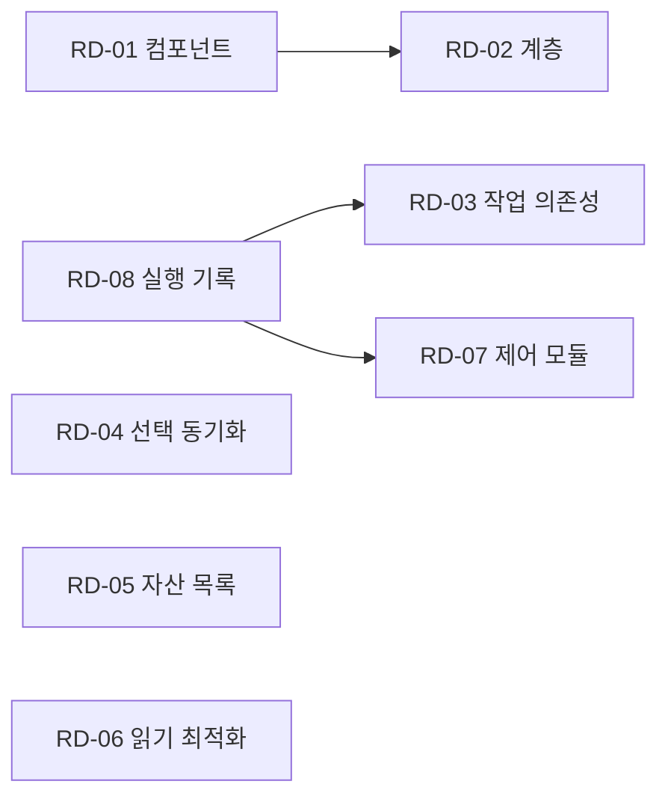

# 다음 개발 작업과 Cursor 구현 순서

이 문서 묶음은 신규 기능, 사용성, 최적화와 구조 개선을 위한 개발 계획이다. 기준 소스는 `9a6f8ba694666ef5040a296c14b1af49bddcd722`, 제품 버전은 0.26.2다. 0.26.3에서 추가한 이력 시각화는 [현재 상태](CURRENT_STATE.md)에 따로 적는다. 아래 항목은 모두 제안이며 구현 완료나 출시 약속을 뜻하지 않는다.

각 폴더의 `feature.md`는 사용자 동작과 인수 조건, `design.md`는 데이터와 코드 변경 경계, `tasks.md`는 Cursor가 실행할 작업 순서와 검사 명령을 담는다. 기존 회귀 검사를 다시 실행하는 일은 각 변경의 완료 조건이며, 별도 신규 기능으로 세지 않는다.

| ID | 작업 | 분류 | 우선순위 | 선행 조건 | 문서 |
| --- | --- | --- | --- | --- | --- |
| RD-01 | 재사용 컴포넌트와 편집 속성 개선 | Figma 기능·최적화 | 높음 | 현재 기준 | [기능서](RD-01-components/feature.md) · [설계서](RD-01-components/design.md) · [작업서](RD-01-components/tasks.md) |
| RD-02 | 의미 있는 계층과 Frame·Group·Auto Layout 선택 | Figma 제작 기능 | 높음 | RD-01과 공유 파일은 순차 편집 | [기능서](RD-02-layer-structure/feature.md) · [설계서](RD-02-layer-structure/design.md) · [작업서](RD-02-layer-structure/tasks.md) |
| RD-03 | 작업 간 명시적 의존성과 영향 시각화 | 신규 기능 | 높음 | RD-08과 공유 UI 파일 순차 통합 | [기능서](RD-03-task-dependencies/feature.md) · [설계서](RD-03-task-dependencies/design.md) · [작업서](RD-03-task-dependencies/tasks.md) |
| RD-04 | 동기화 변경을 골라 적용하기 | 신규 기능 | 높음 | 기존 pairing과 정상 읽기 | [기능서](RD-04-selective-sync/feature.md) · [설계서](RD-04-selective-sync/design.md) · [작업서](RD-04-selective-sync/tasks.md) |
| RD-05 | 입력 사진·글꼴·CSS 자산 목록 | 신규 기능 | 보통 | 입력 결과의 패널 전달 경로 확정 | [기능서](RD-05-asset-inventory/feature.md) · [설계서](RD-05-asset-inventory/design.md) · [작업서](RD-05-asset-inventory/tasks.md) |
| RD-06 | 목적별 네이티브 읽기와 제한된 캐시 | 성능 최적화 | 보통 | 전체 읽기 경로 보존 | [기능서](RD-06-native-read/feature.md) · [설계서](RD-06-native-read/design.md) · [작업서](RD-06-native-read/tasks.md) |
| RD-07 | 제어 전송과 실행 정책의 모듈 경계 | 코드 아키텍처 | 보통 | RD-08의 변경과 순차 통합 | [기능서](RD-07-runtime-boundaries/feature.md) · [설계서](RD-07-runtime-boundaries/design.md) · [작업서](RD-07-runtime-boundaries/tasks.md) |
| RD-08 | 실행 수명주기와 충돌 복구 내역 | 신규 기능·아키텍처 | 높음 | 기존 제어 journal | [기능서](RD-08-operation-lifecycle/feature.md) · [설계서](RD-08-operation-lifecycle/design.md) · [작업서](RD-08-operation-lifecycle/tasks.md) |

## 권장 실행 순서

1. RD-01의 텍스트 속성 개선을 먼저 마친다. 레이아웃 차이 분류와 다중 variant 축은 같은 문서의 후속 단위로 나눈다.
2. RD-02에서 선언한 컨테이너만 만든다. 동시에 다른 작업자가 RD-04의 Python 계획과 패널 선택 계약을 작업할 수 있다.
3. RD-08의 journal 조회와 읽기 전용 복구 표시를 마친다. 그 뒤 RD-03을 통합해 같은 Workspace 파일의 동시 편집을 피한다. RD-03의 task·artifact identity는 RD-08과 독립적이므로 데이터 모델 구현 자체는 먼저 진행할 수 있다.
4. RD-05의 전달 경로를 확정하고 자산 목록을 붙인다. RD-06은 실제 전체 읽기와 비교하며 opt-in으로 진행한다.
5. RD-07은 제어 프로토콜이 안정된 뒤 별도 구조 변경으로 수행한다. 기능 추가와 대규모 파일 이동을 한 변경에 섞지 않는다.

화살표는 이 계획에서 정한 통합 순서다. RD-08에서 RD-03으로 가는 선은 공유 UI 파일의 작성 순서를 뜻하며 데이터 의존성은 아니다. 현재 사용자의 작업들이 실제로 서로 원인이 된다는 증거로 사용하지 않는다.

## 병렬 작업 경계

RD-01과 RD-02는 `code.js`, `direction_review.js`를 공유하므로 파일 작성자를 겹치지 않는다. RD-03과 RD-08은 `Workspace.jsx`, `workspace_host.js`, `figma_control.py`의 통합 작성자를 한 명으로 둔다. RD-07은 이 파일들의 구조를 바꾸므로 같은 시점에 진행하지 않는다. RD-04의 `graph_sync.py` 변경과 RD-06의 discovery 소비자 변경도 순차 통합한다.

기능별 브랜치와 별도 worktree를 사용하되, 병합된 작업은 요청된 정리 정책에 따라 main에 통합한 뒤 제거한다. 공유 ZIP에는 로컬 workspace·pairing·control 값이나 개인 절대 경로를 넣지 않는다.

## Cursor 시작점

[Cursor 전달서](CURSOR_HANDOFF.md)의 공통 프롬프트에 하나의 ID만 지정한다. 계획 전체를 한 번에 구현하도록 요청하지 않는다. [현재 상태](CURRENT_STATE.md)와 해당 기능의 세 문서를 먼저 읽고, 현재 checkout과 차이가 있으면 소유 코드에서 다시 확인한다. 작업이 끝나면 [패치 기록 계약](../llm-wiki/integration.md)에 따라 CHANGELOG와 상세 Wiki를 함께 갱신한다.
