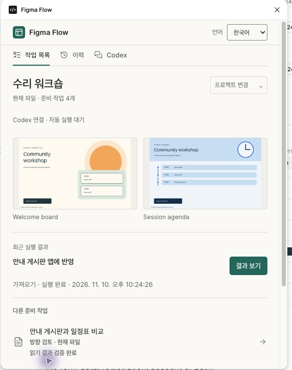
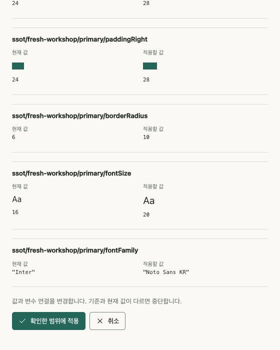

# Figma Flow 0.23.0 quick start

[한국어 guide](figma-guide.md) · [日本語](figma-guide-ja.md)

Register **one Figma Flow development plugin**. Launch it manually in the target Figma Design file once per plugin session. Codex can then run prepared operations through private localhost control without repeated button clicks. A closed plugin must be reopened; updates may also require reopening. There is no hidden background launcher or arbitrary remote code evaluation.

## Install once

```sh
git clone --branch v0.23.0 https://github.com/jonsoku-dev/figma-flow.git
cd figma-flow
codex plugin marketplace add "$PWD"
codex plugin add figma-flow@figma-flow-local
codex plugin list --marketplace figma-flow-local
```

Check the installed version and both plugin manifests are `0.23.0`. Use a project Python environment with `requirements-optional.txt`. Workspace preparation currently supports POSIX hosts, including macOS/Linux; retain standalone compatibility on unsupported hosts. Logins and desktop access approvals remain user actions.

Reuse your workspace if it exists. Otherwise obtain your own ID in Figma Desktop through **Plugins → Development → New plugin → Figma Design → Custom UI**, then initialize a private workspace:

```sh
python3 tools/figma_workspace.py init --workspace PRIVATE_DIR --id-from OWN_MANIFEST.json
python3 tools/figma_workspace.py prepare --workspace PRIVATE_DIR \
  --key invite-discovery --title "Invite baseline" --project "Invite" --kind discover -- \
  --file-key FILE --page-id PAGE
```

Replace placeholders with actual paths and native scope. Register only `PRIVATE_DIR/manifest.json`. Keep the complete private directory, including hidden generations. Private plugin data is tied to its original Figma plugin ID; changing an ID does not migrate ownership. [Full identity and migration guidance](figma-guide.md#5-고정-작업공간-등록과-검토-작업-준비).

## Let Codex run prepared work

```sh
python3 tools/figma_control.py enable --workspace PRIVATE_DIR --port 43180
python3 tools/figma_workspace.py refresh --workspace PRIVATE_DIR
python3 tools/figma_control.py serve --workspace PRIVATE_DIR
```

Keep the service running, then manually launch **Figma Flow** in the correct file. From a separate Codex CLI execution:

```sh
python3 tools/figma_control.py run --workspace PRIVATE_DIR --key invite-discovery \
  --operation read --file-key FILE --page-id PAGE --expected-revision REVISION --timeout 120
python3 tools/figma_control.py status --workspace PRIVATE_DIR --id OPERATION_ID
```

Use the actual current revision from `figma_workspace.py list`. The service and Figma Desktop use the same computer's localhost. `--focus-page` can focus only the exact signed task page in the current file. `--no-wait` acknowledges a request, so inspect its status afterward.

| Prepared kind | Operation |
|---|---|
| `review` | `create` |
| `import` | `import`, `read`; `sync` only with admitted paired app state |
| `discover` | `read` |
| `sync` | `read`, `apply` |

Verify the returned `readback` artifact with the normal checker. Direction review uses `verify-native-review`; production uses `--require-match` and `native_handoff.py`; graph sync also needs actual web proof and `pair`. An `ok` receipt does not approve a design or prove browser parity. Preserve failed/expired/uncertain receipts. Re-read native state before retrying an uncertain write. Human direction selection remains separate.

Changed tasks use `prepare --replace-expected CURRENT_REVISION`. `prepare` or `refresh` publishes updated metadata. Desktop auto-reload behavior varies: if the running revision is old, reopen the same plugin rather than re-registering another manifest.

## Read the UI

Use **Language** to choose **한국어 / English / 日本語**. Source names, actual values, raw JSON and native diagnostics stay unchanged. **Next action** suggests the next prepared step; **History** distinguishes requests, execution, readback, verification and failures. Older revision records do not prove the current revision. Local history can be unavailable; retain actual result artifacts.



If control is unavailable, open the task manually. Import offers **Import or reopen**, then **Read current design → Save JSON file**. Review offers generation and JSON download. Discovery is read-only. Graph sync shows before/after changes and requires its explicit confirmation to apply; canceling closes confirmation, not an operation already started.



Keyboard focus, labeled controls, status announcements and Figma light/dark themes are supported. Use Tab/Shift+Tab, arrow keys for tabs, and Enter/Space to activate controls. Check your required assistive-technology and zoom conditions in the actual product.

For an originating chat, review selection/request content before copying or explicitly queuing it. Opening a chat does not send a message; a queued message is not proof that an agent consumed or executed it. [Chat setup](figma-guide.md#11-작업을-준비한-codex-채팅으로-연결).

Design critique adapts Damir Sokolovsky's [unslop](https://github.com/heydamir/unslop), CC BY 4.0. [Credit, license and authoritative UI references](../README.md#라이선스와-참고).
