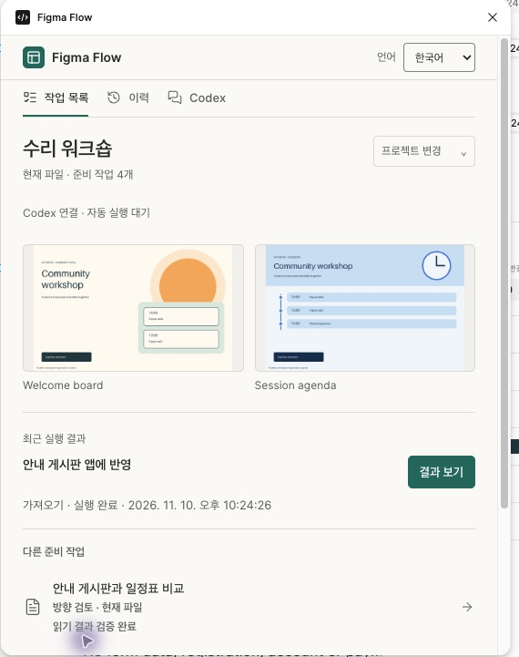
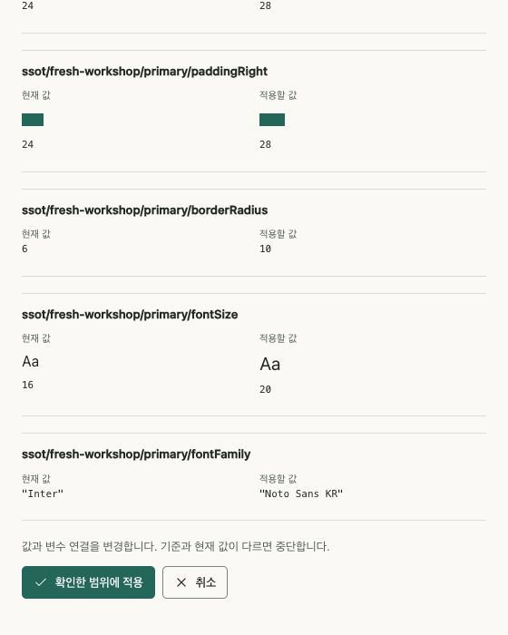

# Figma Flow 0.24.0 クイックスタート

[한국어ガイド](figma-guide.md) · [English](figma-guide-en.md)

利用者の実行に Computer Use や公式 Figma MCP は不要です。開発者は別途許可された環境で Computer Use を検証に使えます。

登録する開発プラグインは **Figma Flow ひとつ**です。対象の Figma Design ファイルで、プラグインの実行セッションごとに一度、手動で起動します。その後は Codex が非公開の localhost 接続で準備済みの操作を実行でき、毎回ボタンを押す必要はありません。閉じた場合や更新後には再起動が必要なことがあります。非表示の常駐起動や任意のリモートコード評価は行いません。

## Computer Use を使わずにフォントを適用する

デザインの元データでファミリーとスタイルを指定します。例えば見出しは **Hahmlet Bold**、本文は **Noto Sans KR Regular** です。対象ファイルで Figma Flow を開くと、案の生成時にプラグインが利用可能なフォントを確認し、必要なスタイルを読み込みます。指定したスタイルがなければページを生成する前に停止します。組織で利用できるフォントを用意するか、元データの指定を変更して再度準備してください。Web に同梱したフォントは Figma 側でも利用できる必要があります。

ローカル接続が許可されていれば Codex が結果を受け取ります。接続も制限されている場合は、レビューパネルで案を生成し、保存した結果 JSON を Codex に渡して実際のファミリー・スタイルを照合します。

## 初回だけ登録

```sh
git clone --branch v0.24.0 https://github.com/jonsoku-dev/figma-flow.git
cd figma-flow
codex plugin marketplace add "$PWD"
codex plugin add figma-flow@figma-flow-local
codex plugin list --marketplace figma-flow-local
```

インストール先と両方の plugin manifest が `0.24.0` か確認します。プロジェクト用 Python 環境に `requirements-optional.txt` を導入してください。現在、作業空間の準備は macOS/Linux などの POSIX 環境に対応しています。未対応環境では従来の standalone 互換経路を維持します。ログインやデスクトップのアクセス承認は利用者が行います。

既存の作業空間があれば再利用します。初回は Figma Desktop の **プラグイン → 開発 → 新しいプラグイン → Figma Design → Custom UI** で自分の ID を取得し、非公開の作業空間を作成します。

```sh
python3 tools/figma_workspace.py init --workspace PRIVATE_DIR --id-from OWN_MANIFEST.json
python3 tools/figma_workspace.py prepare --workspace PRIVATE_DIR \
  --key invite-discovery --title "招待画面の基準" --project "招待" --kind discover -- \
  --file-key FILE --page-id PAGE
```

プレースホルダーは実際のパス・対象に置き換えます。Figma に登録するのは `PRIVATE_DIR/manifest.json` だけです。隠し generation を含むフォルダー全体を保管してください。private plugin data は元のプラグイン ID に属します。ID の書き換えは所有権の移行になりません。[ID と移行の詳細](figma-guide.md#5-고정-작업공간-등록과-검토-작업-준비)。

## Codex に操作を任せる

```sh
python3 tools/figma_control.py enable --workspace PRIVATE_DIR --port 43180
python3 tools/figma_workspace.py refresh --workspace PRIVATE_DIR
python3 tools/figma_control.py serve --workspace PRIVATE_DIR
```

サービスを実行したまま、正しいファイルで **Figma Flow** を手動起動します。別の Codex CLI 実行から次を使います。

```sh
python3 tools/figma_control.py run --workspace PRIVATE_DIR --key invite-discovery \
  --operation read --file-key FILE --page-id PAGE --expected-revision REVISION --timeout 120
python3 tools/figma_control.py status --workspace PRIVATE_DIR --id OPERATION_ID
```

`figma_workspace.py list` が示す現在の revision を使います。サービスと Figma Desktop は同じコンピューターの localhost で接続します。`--focus-page` は、現在のファイル内の署名済み対象ページにだけ移動できます。`--no-wait` は要求の受付だけなので、後で status を確認します。

| 準備した kind | operation |
|---|---|
| `review` | `create` |
| `import` | `import`, `read`。許可済みの paired app 状態がある場合のみ `sync` |
| `discover` | `read` |
| `sync` | `read`, `apply` |
| `native-edit` | `read`, `apply` |

返された `readback` ファイルを通常の検証ツールに渡します。方向検討は `verify-native-review`、本制作は `--require-match` と `native_handoff.py`、グラフ同期は実際の Web 計測と `pair` も必要です。`ok` はデザイン承認やブラウザーとの一致を保証しません。失敗・期限切れ・結果不明の記録を保管し、不明な書き込みを再試行する前に実際の状態を読み直します。候補の選択は利用者の明示的な回答で行います。

変更したタスクは `prepare --replace-expected CURRENT_REVISION` で更新します。`prepare` / `refresh` はメタデータを公開しますが、Desktop の自動再読み込みは環境次第です。古い revision のままなら同じプラグインを開き直し、別の manifest を追加登録しないでください。

## 選択した案の本制作とコントラスト

選択済みの1案を **PRODUCTION** ページに作成し、検討時の画像・配置・動作を維持します。レイアウトは `figma-flow-authored-native-production-v1`、`scope: selected-production`、`sourceSelection` を持ちます。`figma-flow-selected-production-change-v1` の変更要求に、選択・検討/本制作レイアウト・グラフ・実際の管理されたユーザー要求と変更の前後値を固定します。対応範囲は許可済みの `contrast` と `sync` です。sync は見た目の再設計を許可しません。

```sh
python3 tools/figma_workspace.py prepare --workspace PRIVATE_DIR --key selected-production \
  --title "Selected production" --project "My project" --kind review -- \
  --selection PROJECT/review/selection.json --layout PROJECT/production/native-layout.json \
  --product-graph PROJECT/production/graph.json --change-request PROJECT/production/change-request.json \
  --file-key FILE
python3 tools/figma_draft.py verify-production --packet ARTIFACTS/packet.json --readback ACTUAL.json
```

ローカル制御の `--operation create` を現在の正確なファイル・ページ・revision で実行します。`ARTIFACTS` は準備結果が返す成果物ディレクトリです。専用の検証で実際の `figma-flow-native-selected-production-readback-v1` と元の固定情報を照合します。作成・検証は新しい選択や承認を作成しません。構造化された `design.json` の取り込みには従来の native-handoff 検査を使います。[入力契約](figma-guide.md#selected-rich-production)。

`contrast-unknown` は判定できないという警告であり、低いコントラストを測定したという意味ではありません。固定された画像と対応するグラデーションを合成し、テキスト領域下の全背景ピクセルの最小値を保守的に計算します。未解決の場合は理由と `min_ratio: null` を残します。不透明な背景板を既定の修正として追加しません。選択された画像を保ち、実際の Figma・Web の確認結果を別に記録します。

## 準備済みJSONによるネイティブ編集

`native-edit` は独立したタスク種別で、operation は `read` と `apply` です。正確なファイル・ページ・ノードまたはローカル変数のモード・前後値を `figma-flow-native-edit-plan-v1` に固定し、`prepare --kind native-edit -- --plan PLAN.json` で準備します。実際の Figma API で変更し、任意の JavaScript は評価しません。値や revision が古ければ書き込みを停止します。復元の衝突を保管し、結果不明の書き込みを再試行する前に現在値を読み取ります。グラフへの反映と Web 照合は別途行います。[計画例と制限](figma-guide.md#prepared-native-edit)。

## 画面の見方

上部の **言語**から **한국어 / English / 日本語**を選びます。元の画面名・実際の値・JSON・ネイティブエラーは翻訳しません。**次の操作**は準備済みタスクから候補を示します。**履歴**では要求・実行・読み取り・検証・失敗を区別します。古い revision の履歴は現在の証拠ではありません。ローカル履歴が保存できない場合もあるため、実際の結果ファイルを保管してください。



制御接続を使えない場合は手動でタスクを開けます。読み込みは **読み込む・既存ページを開く**、続いて **現在のデザインを読み取る → JSON ファイルを保存**です。検討案は作成後に JSON を保存します。文書読み取りは書き込みません。グラフ同期は変更前後を確認してから明示的に適用します。キャンセルは確認画面を閉じる操作で、開始済みの処理を取り消すものではありません。



キーボードのフォーカス表示、ラベル、状態通知、Figma のライト／ダークテーマに対応します。Tab・Shift+Tab、タブの矢印キー、Enter・Space で操作できます。必要な支援技術や拡大表示の条件は実際の製品で確認してください。

元の Codex チャットへ渡すときは選択と要求のプレビューを確認し、コピーまたは明示的なキュー送信を使います。チャットを開くだけでは送信しません。キューへの追加とエージェントの受信・実行は別です。[チャット接続](figma-guide.md#11-작업을-준비한-codex-채팅으로-연결)。

デザイン批評には Damir Sokolovsky の [unslop](https://github.com/heydamir/unslop) を CC BY 4.0 に基づき翻案しています。[出典・ライセンス・UI の公式参考資料](../README.md#라이선스와-참고)。
