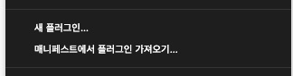
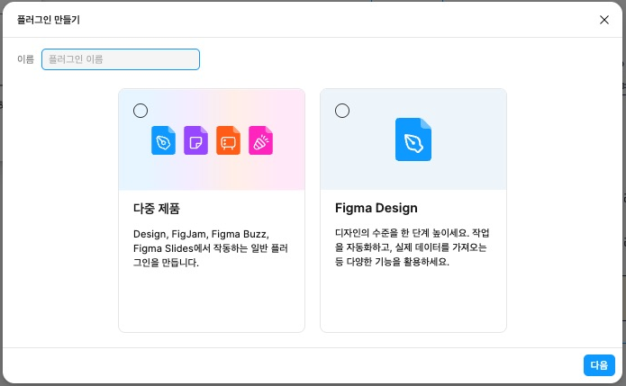
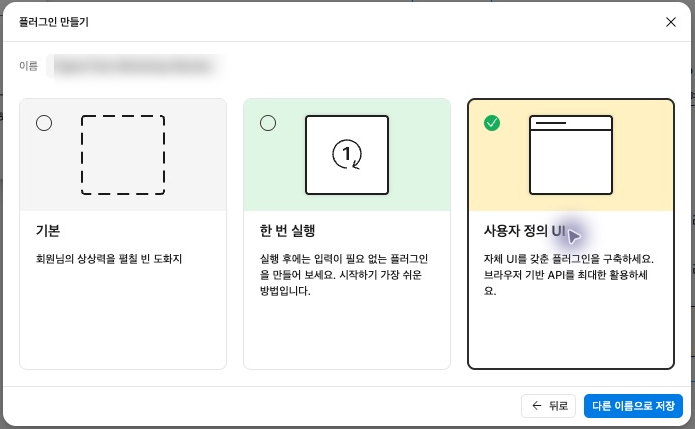
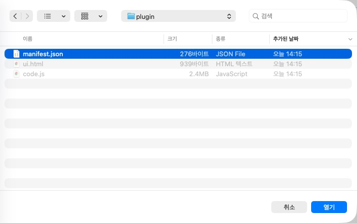
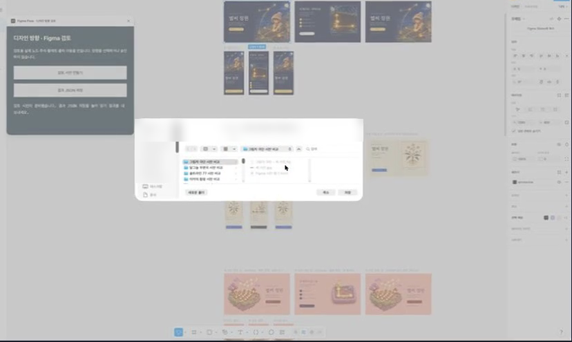
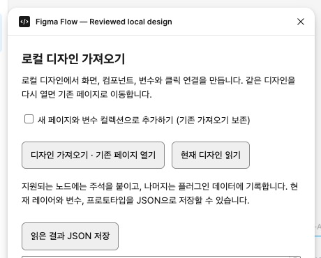
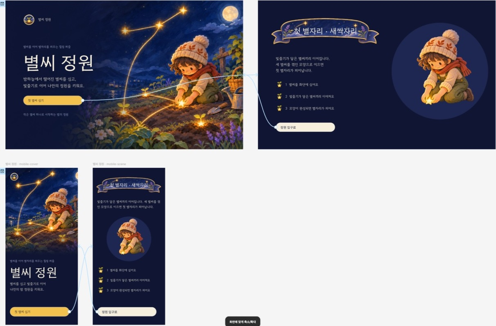

# 처음 설치해서 Figma 화면을 검증하기까지

이 가이드는 **내 컴퓨터의 Codex와 Figma Desktop에서** 워크숍 예제의 두 시안을 비교하는 과정부터 시작합니다. 실제 프로젝트로 옮길 때는 8단계에서 내 브리프와 디자인 시스템을 연결하세요. 클릭을 Codex에 맡기거나 직접 수행하는 두 방식 모두 같은 결과 JSON으로 검증합니다. [복사해서 쓰는 설치 프롬프트](codex-setup-prompts.md)

## 1. 두 플러그인의 위치 확인

| 어디에서 | 설치하거나 여는 것 | 역할 |
|---|---|---|
| Codex | 이 저장소의 `.agents/plugins/marketplace.json`을 통해 `figma-flow` 설치 | 브리프·자료를 읽고, 시안·그래프·Figma용 패키지를 생성하고 검증 |
| Figma Desktop | Codex가 프로젝트별로 생성한 `plugin/manifest.json` 또는 `figma-plugin/manifest.json` | 현재 Design 파일에 편집 가능한 화면·주석·컴포넌트·변수를 만들고 읽기 결과를 내보냄 |

Mac 또는 Windows용 Figma Desktop에서 편집할 수 있는 **Figma Design** 파일을 엽니다. 첫 연습은 여유 페이지가 있는 연습용 파일을 권장합니다. 일반 Design 모드에서 진행합니다. Figma 계정의 가입·로그인은 사용자가 수행합니다. [Figma 개발 플러그인 안내](https://help.figma.com/hc/en-us/articles/360042786733-Create-a-classic-plugin-for-development)

## 2. 클론하고 Codex에 설치

아래 셸 예제는 macOS/Linux의 새 작업 폴더 기준입니다. Windows에서는 [설치 프롬프트](codex-setup-prompts.md)가 PowerShell과 실제 경로에 맞는 명령을 실행하도록 할 수 있습니다. Figma를 직접 조작할 때는 Desktop을 실행한 컴퓨터가 생성된 패키지에 접근할 수 있어야 합니다.

```sh
git clone --branch v0.18.1 https://github.com/jonsoku-dev/figma-flow.git
cd figma-flow
git describe --tags --exact-match
codex plugin marketplace add "$PWD"
codex plugin add figma-flow@figma-flow-local
codex plugin list --marketplace figma-flow-local
```

태그는 `v0.18.1`, 목록은 `figma-flow@figma-flow-local`, `installed, enabled`, `0.18.1`이어야 합니다. Codex에서 이 폴더를 열고 새 채팅을 시작해 `$figma-flow`를 선택합니다. 같은 이름의 다른 체크아웃이 등록돼 있다면 목록의 SOURCE 경로부터 확인하세요.

## 3. 첫 비교 예제 준비

Python 3.13, Node.js 26에서 테스트했습니다. 가상환경과 설계 산출물은 클론 폴더의 **바깥**에 둡니다. 아래 명령은 같은 셸에서 순서대로 실행합니다. `workshop-run`은 새 경로여야 합니다.

```sh
PLUGIN_ROOT="$PWD"
python3.13 -m venv ../figma-flow-env
PY="$(cd ../figma-flow-env/bin && pwd)/python"
"$PY" -m pip install -r requirements-optional.txt
"$PY" -B examples/native-direction-review/demo.py --out ../workshop-run
PROJECT="$(cd ../workshop-run && pwd)"
"$PY" -B tools/design_actions.py status --manifest "$PROJECT/review/directions.json"
```

워크숍 안내 게시판과 일정표 두 안이 생성됩니다. 예제 미리보기는 동봉된 Pillow 렌더입니다. 이 시점의 예상 단계는 `NATIVE_REVIEW_PENDING`입니다. 다음 단계에 쓸 매니페스트는 `workshop-run/review/directions.json`입니다.

## 4. Figma에서 내 프로젝트 전용 ID 받기

이미 이 프로젝트의 **검토용** 개발 플러그인 ID를 갖고 있다면 5단계로 갑니다. 처음이면 다음 순서로 받습니다.

1. Design 파일의 왼쪽 위 **메인 메뉴 → 플러그인 → 개발**을 엽니다. 목록 아래 **새 플러그인…**을 누릅니다. 아래 첫 화면에서 나중에 사용할 **매니페스트에서 플러그인 가져오기…** 항목도 확인할 수 있습니다.
2. 이름에는 `Workshop Review`처럼 프로젝트와 용도를 구분하는 이름을 입력하고 **Figma Design → 다음**을 누릅니다.
3. **사용자 정의 UI(Custom UI) → 다른 이름으로 저장**을 누릅니다. 새 전용 폴더를 지정합니다.
4. 저장한 폴더의 `manifest.json`을 엽니다. 큰따옴표 안의 숫자 문자열 `id`가 Figma가 발급한 값입니다. 이 파일의 경로를 Codex에 전달하면 Codex가 숫자를 정확하게 읽을 수 있습니다. Figma 파일 URL의 키, 화면 node ID와는 용도가 다릅니다. 다른 캠페인에서 쓰던 개발 플러그인 ID를 재사용하면 잘못된 패키지가 열릴 수 있습니다.







메뉴 표기는 Figma 버전·언어에 따라 달라질 수 있습니다. [Figma 공식 Quickstart](https://developers.figma.com/docs/plugins/plugin-quickstart-guide/) · [manifest의 id 설명](https://developers.figma.com/docs/plugins/manifest/)

## 5. 검토용 패키지를 만들고 등록

아래 첫 줄의 경로는 4단계에서 저장한 **내** 파일로 교체합니다. `directions.json`은 Codex용, 지금 생성하는 `reviewer/plugin/manifest.json`은 Figma용입니다.

```sh
ID_MANIFEST="/내가/저장한/Workshop Review/manifest.json"
FIGMA_PLUGIN_ID=$("$PY" -c 'import json,sys; print(json.load(open(sys.argv[1]))["id"])' "$ID_MANIFEST")
"$PY" -B "$PLUGIN_ROOT/tools/design_actions.py" prepare-native-review \
  --manifest "$PROJECT/review/directions.json" --plugin-id "$FIGMA_PLUGIN_ID" \
  --out "$PROJECT/reviewer"
```

1. 명령이 성공하면 출력의 `prepared.manifest`를 확인합니다. 압축 패키지만 전달받았다면 ZIP을 먼저 풉니다. 한 폴더에 `manifest.json`, `code.js`, `ui.html`이 있어야 합니다.
2. Desktop에서 **플러그인 → 개발 → 매니페스트에서 플러그인 가져오기…**를 누릅니다. `reviewer/plugin/manifest.json`을 선택하고 **열기**를 누릅니다. 아래 캡처는 같은 선택 창에서 본제작 패키지의 파일을 고른 모습입니다.
3. 이미 같은 ID의 새 플러그인 템플릿이 등록되어 패키지를 다시 등록할 수 없다면, 먼저 ID와 등록된 전용 폴더를 확인합니다. 첫 연습에서 만든 템플릿을 별도 보관한 뒤, 그 전용 폴더에서 생성 패키지의 세 파일을 함께 사용합니다. 직접 수정한 다른 플러그인의 폴더에는 복사하지 마세요.
4. **플러그인 → 개발**에서 검토 플러그인을 실행합니다. 검색을 사용할 때는 **개발(Development)** 항목을 고릅니다.



## 6. 시안 만들기, 결과 저장, 대조

1. 대상 파일·현재 페이지를 확인하고 플러그인 창에서 **검토 시안 만들기**를 누릅니다. 완료 메시지가 나올 때까지 기다립니다.
2. 생성된 검토 페이지에서 후보별 데스크톱·모바일 화면, 팔레트, **주석 읽기** 보드를 확인합니다. 주석의 링크가 해당 화면·버튼으로 이동하는지, 프로토타입의 주요 버튼과 복귀 경로가 각 후보 안에서 연결되는지 봅니다.
3. 같은 창에서 **결과 JSON 저장**을 누릅니다. 예를 들어 프로젝트 안에 `review-readback.json`으로 저장합니다. Computer Use가 없는 경우 이 세 번의 조작(실행·생성·저장)은 사용자가 하고, 저장한 파일의 위치를 Codex에 알려 줍니다.
4. 실제로 저장된 파일 경로로 아래 명령을 실행합니다.



```sh
"$PY" -B "$PLUGIN_ROOT/tools/design_actions.py" verify-native-review \
  --manifest "$PROJECT/review/directions.json" \
  --readback "$PROJECT/review-readback.json"
"$PY" -B "$PLUGIN_ROOT/tools/design_actions.py" status \
  --manifest "$PROJECT/review/directions.json"
```

검증 성공 시 `WAIT_SELECTION`입니다. 원본과 다른 Figma 파일·패킷·후보의 결과를 썼다는 오류가 나오면, 사용한 검토 플러그인과 대상 페이지를 확인하고 다시 내보냅니다. JSON을 손으로 수정하면 재검증 근거가 사라집니다.

## 7. 비교와 실제 선택 기록

Codex가 화면을 열어 읽기 순서, 주 행동의 위치, 입력 오류·복귀, 모바일에서의 접근성을 비교하고 추천안을 설명할 수 있습니다. 검토 갤러리와 현재 리뷰 ID·해시·후보 ID를 제시한 뒤, 본제작에 사용할 후보를 사용자가 실제 채팅에서 지정합니다. Codex는 그 답이 들어 있는 로컬 관리 기록을 확인해 `design_actions.py select`와 `validate-selection`을 실행합니다. 관리 기록에는 다른 대화가 있을 수 있으므로 GitHub에 첨부하지 않습니다. 후보나 리뷰가 바뀌면 새 후보를 다시 비교합니다. [선택 명령과 기록 계약](../skills/figma-flow/references/direction-selection.md#선택과-후속-작업)

## 8. 내 기획과 디자인 시스템으로 시작

예제 대신 새 프로젝트 폴더에 기획서와 자료를 두고 Codex에 다음처럼 요청합니다.

> 첨부한 기획서로 팀원 초대 화면을 만들어 줘. 이 GitHub 저장소의 MUI 테마와 컴포넌트를 기준으로 해. 전문 분석 보고서와 모바일 캡처를 참고하고, 이메일 오류·제출 중·완료 상태를 포함해. 두 가지 배치를 비교해서 네 추천과 근거를 보여 줘. 검토 목적지는 Figma야.

Codex는 실제 적용 버전·테마·컴포넌트 경로와 상태를 확인해 `brief.md`, `research.md`, 그래프, 후보 파일과 `candidate-spec.json`을 준비합니다. 단일 텍스트 분석 보고서는 기존 `--research`에 그대로 지정할 수 있습니다. 출처가 여러 개면 핵심 관찰과 URL·커밋·파일 위치를 한 문서에 모읍니다. 코드 라이브러리에 대응해 만든 Figma 컴포넌트와 실제 연결된 Figma 라이브러리는 명세에서 구분합니다.

```sh
# 프로젝트 루트에서, 후보 원본과 에이전트의 비교 자료가 준비된 순서대로 실행
"$PY" -B "$PLUGIN_ROOT/tools/design_actions.py" draft --project . \
  --brief brief.md --research research.md --from-existing candidate-spec.json \
  --review-destination figma --out reviews/r1
"$PY" -B "$PLUGIN_ROOT/tools/design_actions.py" review \
  --manifest reviews/r1/directions.json --judgement agent-review.json
```

새 UI를 본제작할 때는 [디자인 검토 계약](../skills/figma-flow/references/design-review.md)에서 요구하는 Impeccable 및 제품에 적용할 디자인 스킬의 원본도 확인합니다. 브라우저에서 흐름을 재현한 캡처는 분석 자료로 쓸 수 있습니다. 최종 디자인 검토에는 해당 검사기가 허용하는 캡처 출처와 폰트·상태·에셋 증거가 필요합니다.

이후 4~7단계의 매니페스트 경로를 `reviews/r1/directions.json`으로 맞춥니다. **브라우저에서만 비교하려는 요청**은 브리프에 `Local HTML only`라고 명시하고 `--review-destination local`을 사용합니다. 이 경로에서는 로컬 HTML·스크린샷을 비교하며 Figma 등록을 생략합니다. [두 디자인 시스템의 실제 비교 예시](design-system-trials.md)

## 9. 선택한 안을 Figma 본제작으로 전달

본제작은 **검토용 패키지와 별도**입니다. Codex가 선택 기록과 정확히 같은 제품 그래프, 디자인 원본을 읽습니다. 생성 에셋이 필요한 기획은 먼저 배치를 고정해 실제 생성 결과와 영수증을 연결합니다. 아래 예시에서 파일명은 해당 프로젝트의 실제 출력으로 바꿉니다.

```sh
"$PY" -B "$PLUGIN_ROOT/tools/design_bundle.py" --design production/design.json \
  --graph selected/graph.json --selection reviews/r1/selection.json \
  --id-from "/내가/발급받은/Production/manifest.json" --out production/bundle
# 에셋이 필요한 프로젝트는 같은 명령에 --batch BATCH.json --asset-receipts RECEIPTS.json 추가
```

1. 4~5단계처럼 이번에는 **본제작용** 전용 ID와 생성한 `production/bundle/figma-plugin/manifest.json`을 등록합니다.
2. 대상 Design 파일에서 **Figma Flow — Reviewed local design**을 엽니다. **디자인 가져오기 · 기존 페이지 열기**를 누릅니다. 같은 원본을 다시 열면 기존 페이지로 이동합니다. 별도 새 페이지·컬렉션을 만들려는 경우에만 해당 체크박스를 사용합니다.
3. 화면과 컴포넌트를 확인하고 **현재 디자인 읽기 → 읽은 결과 JSON 저장**을 누릅니다. 아래는 실제 본제작 플러그인 창과 이전 캠페인의 완성 화면 예시입니다.





4. 번들 폴더 안에서 같은 읽기 결과로 두 검사를 실행합니다. `--expected`에는 이 번들이 생성한 계약을 전달합니다. 명령의 종료 코드를 직접 확인합니다.

```sh
cd production/bundle
"$PY" -B "$PLUGIN_ROOT/tools/figma_bridge.py" --inspect-readback ../production-readback.json \
  --input preview/resolved.json --expected figma-plugin/expected-native-handoff.json --require-match
"$PY" -B "$PLUGIN_ROOT/tools/native_handoff.py" --readback ../production-readback.json \
  --contract figma-plugin/expected-native-handoff.json --out ../native-handoff
```

첫 검사는 종료 코드 0과 `matches_supplied_source: true`, 두 번째는 `report.json`의 `passed: true`를 확인합니다. `screen-spec.md`에서 실제 화면·조작·상태·토큰을 읽을 수 있습니다. 프로젝트 전체는 실제 앱·상태·테스트와 `bindings.json`을 연결한 뒤 `check_project.py --init --brief … --graph … --bindings … --out 새_검사_폴더`로 확인합니다. `summary.json`에서 신선도·네이티브 전달·디자인 검토를 각각 읽으세요. 게임 캠페인의 Figma 생성 스킨과 글자 길이 측정은 0.18 계열의 미완료 범위입니다.

## 막힌 위치 찾기

| 보이는 현상 | 확인할 위치와 다음 행동 |
|---|---|
| Codex에서 플러그인이 보이지 않음 | `codex plugin list --marketplace figma-flow-local`에서 설치 경로·버전·활성 여부를 확인하고 새 Codex 채팅을 엽니다. |
| Figma에서 manifest 오류, 다른 캠페인이 열림 | 검토는 `reviewer/plugin/manifest.json`, 본제작은 `bundle/figma-plugin/manifest.json`입니다. Figma가 발급한 전용 ID와 실제로 등록된 폴더를 확인합니다. |
| 품질 검사에서 패키지 생성 중단 | `design-quality.json`의 오류가 지목한 레이어·버튼·폰트를 고친 다음 원본과 검토 패킷을 다시 생성합니다. |
| 임베드 에셋 용량 경고 | base64 합계가 4 MB를 넘었다는 뜻입니다. 생성된 ZIP은 사용할 수 있습니다. 줄일 경우 원본이 달라지므로 다시 패키징·검증합니다. |
| 저장 버튼이 비활성 | 검토용은 시안 생성, 본제작용은 현재 디자인 읽기가 끝나야 해당 결과를 저장할 수 있습니다. |
| 페이지 부족, 끊긴 연결 | 편집 가능한 여유 페이지와 연결 상태를 확인한 다음 대상에 맞게 다시 실행합니다. 기존 페이지·파일을 삭제할 필요는 없습니다. |
| 검사 결과가 stale 또는 blocked | `freshness_unverified`의 노드·사유·누락 파일과 개별 검사 영수증을 확인합니다. 실제 원본·근거를 보완하고 새 출력 폴더에서 다시 검사합니다. |
