# Figma Flow 0.26.2 통합 가이드

[한국어](#korean) · [English](#english) · [日本語](#japanese)

<a id="korean"></a>

설치·사용·업데이트 안내의 정본은 이 문서 하나입니다. [설치 프롬프트](#setup-prompt) · [환경 설정](#environment) · [업데이트와 복구](#updates) · [회사 private 배포](#private-distribution)

이 가이드의 워크숍 예제는 두 시안을 비교합니다. 실제 작업은 구체적인 방향·참조가 있으면 한 안으로 진행하고, 비교를 요청했거나 방향 선택이 필요할 때만 여러 안을 만듭니다. 실제 프로젝트로 옮길 때는 8단계에서 내 브리프와 디자인 시스템을 연결하세요. 사용자가 Figma Flow를 실행 세션마다 한 번 직접 열면 Codex가 localhost 명령으로 작업합니다. 수동 패널도 같은 결과 JSON으로 검증합니다. [복사해서 쓰는 설치 프롬프트](#setup-prompt)

## 1. 두 플러그인의 위치 확인

| 어디에서 | 설치하거나 여는 것 | 역할 |
|---|---|---|
| Codex | 이 저장소의 `.agents/plugins/marketplace.json`을 통해 `figma-flow` 설치 | 브리프·자료를 읽고, 시안·그래프·Figma용 패키지를 생성하고 검증 |
| Figma Desktop | 한 번 등록한 비공개 `WORKSPACE/manifest.json` | **준비된 작업**에서 프로젝트 작업을 열고, 명시적 실행 후 실제 결과를 저장 |

Figma 작업공간 CLI의 준비·갱신은 현재 macOS/Linux의 POSIX 파일 보호를 사용합니다. Windows 로컬 CLI는 이 경로를 지원하지 않으므로 기존 standalone 호환 절차를 유지하거나 지원되는 POSIX 환경에서 준비한 전체 폴더의 전달·실행 범위를 별도로 확인합니다.

Mac 또는 Windows용 Figma Desktop에서 편집할 수 있는 **Figma Design** 파일을 엽니다. 첫 연습은 여유 페이지가 있는 연습용 파일을 권장합니다. 일반 Design 모드에서 진행합니다. Figma 계정의 가입·로그인은 사용자가 수행합니다. [Figma 개발 플러그인 안내](https://help.figma.com/hc/en-us/articles/360042786733-Create-a-classic-plugin-for-development)

## 기본 흐름: 한 번 실행하고 Codex에 맡기기

소비자에게 Computer Use나 공식 Figma MCP 연결을 요구하지 않습니다. Codex는 이 플러그인의 localhost 명령을 사용합니다. 개발자는 별도로 허용된 환경에서 Computer Use로 검수할 수 있지만 제품 실행 의존성은 아닙니다.

1. Codex가 실제 Figma ID로 고정 작업공간과 필요한 작업을 준비합니다. 최초 등록은 4~5절을 따릅니다.
2. 사용자가 대상 Figma Design 파일에서 **Figma Flow**를 직접 한 번 실행하고 열린 상태로 둡니다. 이 실행 세션이 유지되는 동안 Codex가 아래 로컬 제어 명령을 사용할 수 있습니다.
3. Codex가 작업 키·operation·파일·페이지·현재 revision을 고정해 실행하고, 반환된 실제 JSON을 기존 검증기로 대조합니다. 비교 경로의 후보 선택은 실제 사용자 답변을 사용하며, 단일안 경로는 해당 작업을 요청한 실제 지시를 검증합니다.
4. 홈의 **다음 작업**과 **이력**에서 진행·실패·읽기·검증 상태를 확인합니다. 제어 연결이 없으면 **준비된 작업 → 열기**와 아래 패널 버튼이 수동 대체 경로입니다.

```sh
# Codex가 기존 private 작업공간에서 한 번 구성합니다. 포트는 예시입니다.
"$PY" -B "$PLUGIN_ROOT/tools/figma_control.py" enable --workspace "$WORKSPACE" --port 43180
"$PY" -B "$PLUGIN_ROOT/tools/figma_workspace.py" refresh --workspace "$WORKSPACE"
"$PY" -B "$PLUGIN_ROOT/tools/figma_control.py" serve --workspace "$WORKSPACE"
```

`enable`만으로 열린 플러그인 코드가 바뀌지는 않습니다. `refresh` 후 Figma Flow를 실행하세요. `serve`는 보이는 로컬 실행 세션에서 유지하고, 아래 `run`은 Codex의 다른 CLI 실행에서 사용합니다. relay와 Figma Desktop은 같은 Mac 안의 localhost(루프백) 연결을 사용합니다. 이 제어 트래픽은 Mac 밖의 네트워크로 보내지 않습니다. 현재 환경에서 연결이 차단됐다고 가정하지 말고 실제 연결 결과를 확인합니다. 원격 Codex라면 Desktop이 있는 머신에서 서비스와 명령을 실행할 경로가 필요합니다.

```sh
"$PY" -B "$PLUGIN_ROOT/tools/figma_control.py" run --workspace "$WORKSPACE" \
  --key invite-discovery --operation read --file-key ACTUAL_FILE_KEY --page-id ACTUAL_PAGE_ID \
  --expected-revision CURRENT_TASK_REVISION --timeout 120
"$PY" -B "$PLUGIN_ROOT/tools/figma_control.py" status --workspace "$WORKSPACE" --id OPERATION_ID
```

| 준비한 작업 종류 | 허용되는 operation |
|---|---|
| `review` | `create` |
| `import` | `import`, `read`; 지원되는 paired app 상태가 있을 때만 `sync` |
| `discover` | `read` |
| `sync` | `read`, `apply` |
| `native-edit` | `read`, `apply` — 준비한 네이티브 편집 계획 |

파일 키·페이지·revision은 실제 `list`와 현재 Figma/읽기 자료에서 가져옵니다. `--focus-page`는 **서명된 작업의 정확한 파일·페이지**가 있을 때 같은 파일 안의 그 페이지로만 이동합니다. 다른 파일을 열거나 사용자 화면을 추측하지 않습니다. `--no-wait`는 접수만 반환하므로 `status`로 완료를 확인해야 합니다.

성공 결과의 `readback` 경로를 정상 읽기 자료로 검증합니다. 검토는 `verify-native-review`, 선택된 풍부한 본제작은 `verify-production`을 사용합니다. 구조화된 가져오기는 9절의 `--require-match`·`native_handoff.py`, 그래프는 실제 웹 자료와 `pair`로 대조합니다. `state: ok`와 이력 표시가 디자인 승인·웹 일치·독립적인 출처 인증을 대신하지 않습니다. `error`·`expired`·`uncertain`이면 영수증을 보관하고 현재 상태를 다시 읽으세요. 접수된 쓰기의 결과가 불확실할 때 자동 재시도하지 않습니다.

0.26.2부터 같은 패킷의 준비 예약 또는 소유 보드가 남은 부분 생성 페이지를 발견하면 새 페이지 생성을 중단하고 기존 페이지 ID를 알려줍니다. 원래 graph·사진·노드와 현재 값을 먼저 대조한 뒤, 지원되는 명세 수정 계획으로 누락한 명세·주석·보드 연결만 복구합니다. 이 복구는 과거 영수증을 성공으로 바꾸거나 생성 완료 메타데이터를 대신 복원하지 않습니다. 기존 페이지·사용자 수정을 보존하세요.

Figma 플러그인은 사용자가 시작한 실행 모델이며 사용자가 닫을 수 있습니다([공식 실행 모델](https://developers.figma.com/docs/plugins/how-plugins-run/), [등록·실행 안내](https://developers.figma.com/docs/plugins/plugin-quickstart-guide/)). 닫힌 플러그인을 숨겨서 실행하거나 원격 코드를 평가하지 않습니다. 새 `prepare`/`refresh` 후 자동 재로드 여부는 Desktop 환경에 따라 다릅니다. 이전 revision이면 창을 닫고 **같은 고정 플러그인**을 다시 실행하며 영구 무재시작을 약속하지 않습니다.

진행 중인 네이티브 `run`이 끝난 뒤 같은 작업공간의 작업 목록을 갱신합니다. 플러그인이 이미 가져간 `claimed` 요청이 있으면 `prepare`·`refresh`의 새 게시를 거절합니다. 생성 도중 Desktop의 자동 재로드가 실행을 끊는 일을 줄이기 위한 검사이며, 게시 후의 모든 재로드를 원자적으로 제어하지는 않습니다. 먼저 `status`에서 완료를 확인하고 다음 작업을 준비하세요. 불확실한 실행은 현재 파일을 다시 읽어 복구한 뒤 검증하며, 중단된 자료를 성공 결과로 사용하지 않습니다.

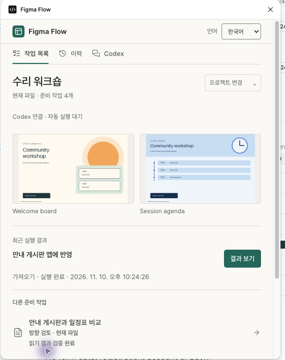

0.24.1부터 run은 큐를 기록하기 전에 같은 작업공간의 실행 중인 서버 버전·구현 해시·지원 작업을 확인합니다. --no-wait도 준비된 서버에 요청을 넣은 뒤 즉시 반환하는 옵션입니다. 구버전·접속 실패·인증 문제 안내가 나오면 기존 작업공간의 서비스만 정상 종료하고 현재 설치본의 serve로 다시 시작하세요. 서버 확인과 실제 Figma 플러그인 실행·읽기 결과는 각각 검증합니다.

### Computer Use 없이 글꼴 적용하기

1. Codex가 시안 원본에 글꼴 패밀리와 스타일을 함께 지정합니다. 예를 들어 제목은 `Hahmlet Bold`, 본문은 `Noto Sans KR Regular`로 준비합니다.
2. 대상 Design 파일에서 Figma Flow를 엽니다. 시안을 생성하면 플러그인이 Figma가 제공하는 패밀리·스타일 목록을 확인하고 필요한 글꼴을 로드합니다. 글꼴 메뉴를 클릭할 필요가 없습니다.
3. 필요한 스타일이 없으면 시안 생성 전 진단에 나온 이름을 확인합니다. 조직에서 제공하는 글꼴을 사용하거나 원본에 사용 가능한 스타일을 지정해 다시 준비합니다. 웹에 포함한 폰트 파일은 Figma에서 별도로 사용할 수 있어야 합니다.
4. Codex가 로컬 제어 연결로 결과를 회수합니다. 오프라인 작업이나 연결 장애 때는 사용자가 **검토 시안 만들기 → 결과 JSON 저장**을 실행하고 파일을 전달합니다. Codex가 실제 텍스트의 `fontName.family`와 `fontName.style`을 원본과 대조합니다.

### 사진 입력 준비

사진 입력은 PNG·JPEG·GIF를 사용하고 가로·세로가 각각 4,096px 이하여야 합니다. 준비 단계에서 이미지 디코딩과 크기를 확인하며 원본을 자동으로 축소하지 않습니다. 큰 원본은 보존하고 제한 안의 사본을 제공하세요. [정상 사진·글꼴 연결 예제](../examples/regression-program/html/positive-assets/README.md)에서 실제 파일과 출처를 확인할 수 있습니다.

### 이력, 다음 작업, 언어와 접근성

현재 작업 상태 차트는 각 task revision의 마지막 관측을 집계합니다. 전체 제품 인수 완료율은 아닙니다. 실행 흐름을 펼치면 같은 실행의 요청·진행·결과를 볼 수 있고 **작업별 이력**으로 좁힐 수 있습니다. 실행 ID가 없는 옛 기록은 연결하지 않습니다. 짧은 펼침 feedback은 reduced-motion 설정에서 제거됩니다.

**다음 작업**은 현재 작업 revision과 최근 실행 자료를 바탕으로 제안합니다. **이력**에서 요청·실행 완료·실제 읽기·검증·실패를 구분하고, 이전 revision의 기록을 현재 결과로 사용하지 않습니다. 최근 기록은 이 기기에 보관되며 로컬 저장소가 없으면 세션 기록만 보일 수 있습니다. 최종 근거는 실제 JSON·검증 명령·웹 관찰 자료입니다.

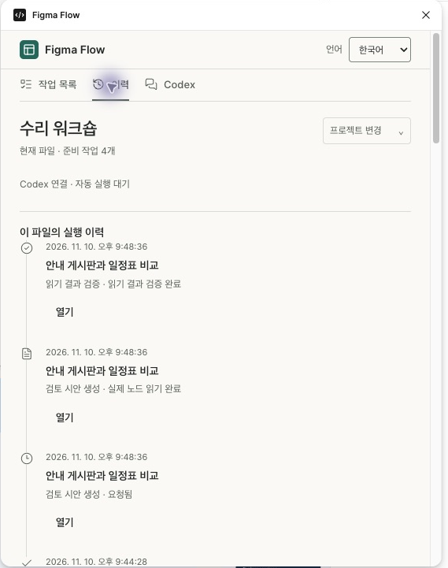

상단 **언어 / Language / 言語**에서 한국어·English·日本語를 선택합니다. 화면명·프로젝트명·사용자 문구와 원본 오류는 번역하지 않습니다. 키보드 Tab·Shift+Tab으로 이동하고, 탭은 방향키와 Enter/Space, 펼침 영역은 Enter/Space로 조작합니다. 초점 표시, 상태 알림, Figma 밝은/어두운 테마를 지원하지만 모든 보조기기 조합의 접근성 인증을 뜻하지는 않습니다.

아래 4~11절은 최초 설치, 작업 준비와 **수동 대체 경로**의 자세한 설명입니다.

### 현재 패널 빠른 찾기

| 패널 | 실제 조작과 결과 |
|---|---|
| 디자인 가져오기 | **가져오기 · 기존 페이지 열기** 또는 별도 페이지 선택 → **현재 디자인 읽기** → **JSON 파일 저장**. 연결된 앱 전용 패키지는 **앱 동기화 / 앱에 반영**을 표시합니다. |
| 디자인 방향 검토 | **검토 시안 만들기** → 완료 확인 → **결과 JSON 저장**. 오류는 **상세 진단 보기**, 배치 실패는 **실패 진단 JSON 저장**에서 확인합니다. |
| Figma 값 읽기 | **Figma 값 읽고 저장**으로 지정 페이지를 읽고 JSON을 다운로드합니다. Figma 파일을 변경하지 않습니다. |
| 컴포넌트 동기화 | 읽기 또는 **적용 범위 확인** → **확인한 범위에 적용**. **취소**는 확인창만 닫습니다. 완료 후 **JSON 다시 저장**으로 결과를 보관합니다. |

## 2. 클론하고 Codex에 설치

아래 셸 예제는 macOS/Linux의 새 작업 폴더 기준입니다. Windows에서는 [설치 프롬프트](#setup-prompt)가 PowerShell과 실제 경로에 맞는 명령을 실행하도록 할 수 있습니다. Figma를 직접 조작할 때는 Desktop을 실행한 컴퓨터가 생성된 패키지에 접근할 수 있어야 합니다.

```sh
git clone --branch v0.26.2 https://github.com/jonsoku-dev/figma-flow.git
cd figma-flow
git describe --tags --exact-match
codex plugin marketplace list --json
codex plugin marketplace add "$PWD" --json
codex plugin add figma-flow@figma-flow-local --json
codex plugin list --marketplace figma-flow-local --json
```

마켓플레이스 이름은 `.agents/plugins/marketplace.json`에서 읽고 회사 복제본은 실제 이름을 사용합니다. 기존 동명 소스가 다른 경로이면 먼저 비교합니다. `add --json`의 실제 `installedPath`를 기록하고 캐시 경로를 추측하지 않습니다. 설치 복사본의 `.codex-plugin/plugin.json`과 `plugin.json`도 대조합니다. 태그는 `v0.26.2`, 목록은 `figma-flow@figma-flow-local`, `installed, enabled`, `0.26.2`이어야 합니다. Codex에서 이 폴더를 열고 새 채팅을 시작해 `$figma-flow`를 선택합니다. 같은 이름의 다른 체크아웃이 등록돼 있다면 목록의 SOURCE 경로부터 확인하세요.

## 3. 첫 비교 예제 준비

Python 3.13, Node.js 26에서 테스트한 예제입니다. 현재 체크아웃의 런타임 통과 여부는 별도 실행 증거로 확인합니다. 가상환경과 설계 산출물은 클론 폴더의 **바깥**에 둡니다. 아래 명령은 같은 셸에서 순서대로 실행합니다. `workshop-run`은 새 경로여야 합니다.

```sh
PLUGIN_ROOT="/plugin add --json이 반환한 실제 installedPath"
python3.13 -m venv ../figma-flow-env
PY="$(cd ../figma-flow-env/bin && pwd)/python"
"$PY" -m pip install -r "$PLUGIN_ROOT/requirements-optional.txt"
"$PY" -B "$PLUGIN_ROOT/tools/skill_dependencies.py" --check
"$PY" -B "$PLUGIN_ROOT/examples/native-direction-review/demo.py" --out ../workshop-run
PROJECT="$(cd ../workshop-run && pwd)"
"$PY" -B "$PLUGIN_ROOT/tools/design_actions.py" status --manifest "$PROJECT/review/directions.json"
```

워크숍 안내 게시판과 일정표 두 안이 생성됩니다. 예제 미리보기는 동봉된 Pillow 렌더입니다. 이 시점의 예상 단계는 `NATIVE_REVIEW_PENDING`입니다. 다음 단계에 쓸 매니페스트는 `workshop-run/review/directions.json`입니다.

<a id="4-figma에서-내-프로젝트-전용-id-받기"></a>

## 4. Figma Flow 작업공간 ID를 한 번 받기

이미 등록한 Figma Flow 작업공간이 있으면 그 고정 manifest와 ID를 재사용합니다. 처음이면 다음 순서로 사용자 소유 개발 ID를 받습니다.

1. Design 파일의 왼쪽 위 **메인 메뉴 → 플러그인 → 개발**을 엽니다. 목록 아래 **새 플러그인…**을 누릅니다. 아래 첫 화면에서 나중에 사용할 **매니페스트에서 플러그인 가져오기…** 항목도 확인할 수 있습니다.
2. 이름에는 `Figma Flow`를 입력하고 **Figma Design → 다음**을 누릅니다.
3. **사용자 정의 UI(Custom UI) → 다른 이름으로 저장**을 누릅니다. 새 전용 폴더를 지정합니다.
4. 저장한 템플릿의 `manifest.json` 경로를 Codex에 전달합니다. 숫자 문자열 `id`는 Figma가 발급한 플러그인 ID이며 파일 URL의 키나 node ID가 아닙니다. 이 ID로 고정 작업공간을 구성하고 이후 모든 작업에 유지합니다. 다른 사람이 소유한 ID를 복사하지 않습니다.

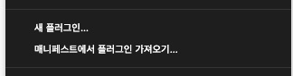

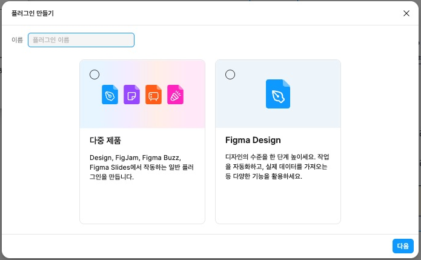

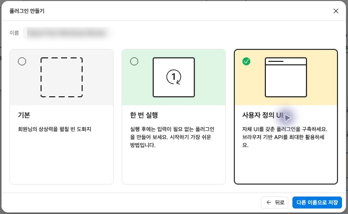

메뉴 표기는 Figma 버전·언어에 따라 달라질 수 있습니다. [Figma 공식 Quickstart](https://developers.figma.com/docs/plugins/plugin-quickstart-guide/) · [manifest의 id 설명](https://developers.figma.com/docs/plugins/manifest/)

## 5. 고정 작업공간 등록과 검토 작업 준비

아래 경로는 자신의 템플릿·비공개 작업공간으로 바꿉니다. `WORKSPACE`는 Git·공유 ZIP 밖에 두고 이후에도 같은 경로를 사용합니다.

```sh
WORKSPACE="/내/비공개/Figma-Flow-Workspace"
"$PY" -B "$PLUGIN_ROOT/tools/figma_workspace.py" init \
  --workspace "$WORKSPACE" --id-from "/내가/저장한/Figma Flow/manifest.json"
"$PY" -B "$PLUGIN_ROOT/tools/figma_workspace.py" prepare \
  --workspace "$WORKSPACE" --key workshop-review --title "워크숍 시안 검토" \
  --project "워크숍" --kind review -- \
  --manifest "$PROJECT/review/directions.json"
"$PY" -B "$PLUGIN_ROOT/tools/figma_workspace.py" list --workspace "$WORKSPACE"
```

Codex는 작업을 요청한 기본 채팅의 `CODEX_THREAD_ID`를 기록하며 하위 실행용 임의 ID로 바꾸지 않습니다. 일반 셸에서는 실제 채팅 UUID를 `prepare --thread-id UUID`로 지정할 수 있습니다. 둘 다 없으면 오프라인 작업으로 준비되고 **대화 미연결**로 표시됩니다. 잘못된 UUID는 거부하며 임의의 ID를 만들지 않습니다. 명령의 `--` 뒤에는 해당 종류의 생성기 **옵션만** 전달합니다. `--out`·`--plugin-id`·`--web-module`은 작업공간 도구가 관리합니다.

1. Figma Desktop에서 **플러그인 → 개발 → 매니페스트에서 플러그인 가져오기…**를 선택하고 고정 경로의 **`WORKSPACE/manifest.json`**을 한 번 등록합니다. 내부 `.generations`의 파일이나 개별 작업 manifest를 대신 등록하지 않습니다.
2. 같은 ID의 템플릿이 이미 등록돼 있으면 실제 등록 경로와 ID를 먼저 대조하고 템플릿을 보존한 뒤 이 고정 manifest로 등록 경로를 맞춥니다. 다른 플러그인 폴더를 덮어쓰지 않습니다.
3. 개발 메뉴에서 **Figma Flow**를 열고 **준비된 작업 → 워크숍 시안 검토 → 열기**를 누릅니다. 목록이 비어 있으면 Codex가 작업을 준비했는지 확인한 뒤 플러그인을 다시 엽니다.

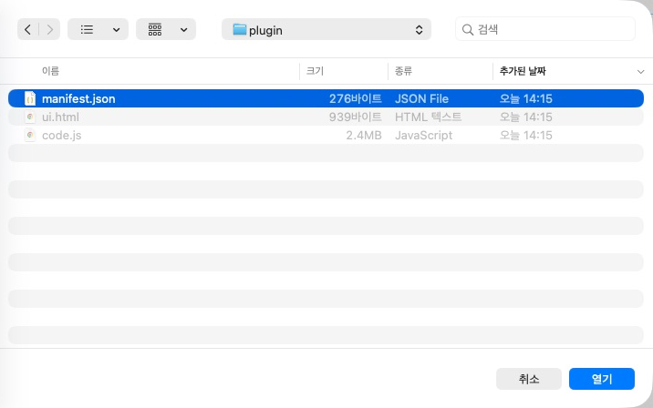

같은 작업 키의 입력이 같으면 재시도는 같은 작업을 유지합니다. 바뀐 원본으로 교체할 때는 `list`가 표시한 현재 revision을 **`--replace-expected REVISION`**에 전달합니다. 작업공간 manifest와 Figma ID는 유지하고 열린 이전 창을 닫아 다시 실행합니다.

새 프로젝트 검증 후 예전 등록을 정리할 때는 [ID·경로 보관과 복원 절차](#updates)를 따릅니다. 현재 고정 작업공간과 문서 데이터는 유지합니다.

**다른 ID의 기존 문서:** private plugin data는 작성한 플러그인 ID에 묶입니다. 원래 ID로 작업공간을 만들거나 원래 standalone 패키지를 유지하세요. 다른 ID의 상태·패키지를 문자열만 바꿔 넣으면 소유권이 이전되지 않습니다. 하나의 새 ID로 통합하려면 기존 ID에서 실제 읽기 자료를 보관하고 별도의 명시적 이관을 준비합니다.

## 6. 시안 만들기, 결과 저장, 대조

1. 수동 경로에서는 홈에서 검토 작업을 열고 패널에 표시된 프로젝트·후보와 대상 파일·페이지를 대조한 뒤 **검토 시안 만들기**를 누릅니다. 생성 중에는 다시 누르지 않고 완료 또는 오류 상태를 확인합니다.
2. 생성된 검토 페이지에서 후보별 데스크톱·모바일 화면, 팔레트, **주석 읽기** 보드를 확인합니다. 주석의 링크가 해당 화면·버튼으로 이동하는지, 프로토타입의 주요 버튼과 복귀 경로가 각 후보 안에서 연결되는지 봅니다.
3. 같은 창에서 **결과 JSON 저장**을 누릅니다. 예를 들어 프로젝트 안에 `review-readback.json`으로 저장합니다. 로컬 제어 연결도 사용할 수 없을 때는 사용자가 패널에서 생성·저장하고 파일 위치를 Codex에 알려 줍니다.
4. 실제로 저장된 파일 경로로 아래 명령을 실행합니다.

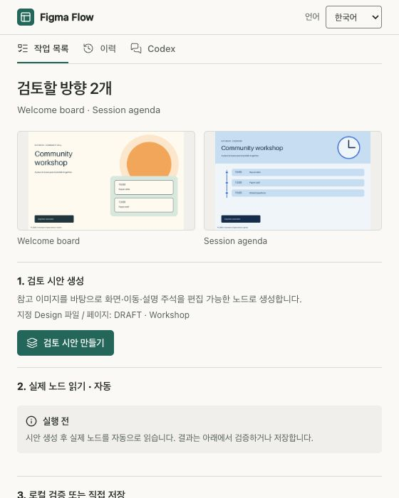

위 이미지는 생성 패키지의 HTML 미리보기입니다. 실제 Figma 생성·검증의 증거는 실행 후 저장한 JSON과 해당 파일의 화면으로 확인합니다.

```sh
"$PY" -B "$PLUGIN_ROOT/tools/design_actions.py" verify-native-review \
  --manifest "$PROJECT/review/directions.json" \
  --readback "$PROJECT/review-readback.json"
"$PY" -B "$PLUGIN_ROOT/tools/design_actions.py" status \
  --manifest "$PROJECT/review/directions.json"
```

검증 성공 시 `WAIT_SELECTION`입니다. 0.18.2부터는 네이티브 글자 높이·겹침·버튼 정렬도 확인합니다. 생성이 차단되면 **실패 진단 JSON 저장**으로 문제 레이어의 배정값과 실측값을 읽고, 해당 위치를 원본 레이아웃에서 수정합니다. 최종 시안은 Figma에서 내보낸 PNG를 실제 화면 크기로 열어 데스크톱과 모바일의 문구·입력 오류·로딩·완료 상태를 비교하세요. 원본과 다른 Figma 파일·패킷·후보의 결과를 썼다는 오류가 나오면, 사용한 검토 플러그인과 대상 페이지를 확인하고 다시 내보냅니다. JSON을 손으로 수정하면 재검증 근거가 사라집니다.

## 7. 비교와 실제 선택 기록

Codex가 화면을 열어 읽기 순서, 주 행동의 위치, 입력 오류·복귀, 모바일에서의 접근성을 비교하고 추천안을 설명할 수 있습니다. 검토 갤러리와 현재 리뷰 ID·해시·후보 ID를 제시한 뒤, 본제작에 사용할 후보를 사용자가 실제 채팅에서 지정합니다. Codex는 그 답이 들어 있는 로컬 관리 기록을 확인해 `design_actions.py select`와 `validate-selection`을 실행합니다. 관리 기록에는 다른 대화가 있을 수 있으므로 GitHub에 첨부하지 않습니다. 후보나 리뷰가 바뀌면 새 후보를 다시 비교합니다. [선택 명령과 기록 계약](../skills/figma-flow/references/direction-selection.md#선택과-후속-작업)

## 8. 내 기획과 디자인 시스템으로 시작

예제 대신 새 프로젝트 폴더에 기획서와 자료를 두고 Codex에 다음처럼 요청합니다.

> 첨부한 기획서로 팀원 초대 화면을 만들어 줘. 이 GitHub 저장소의 MUI 테마와 컴포넌트를 기준으로 해. 전문 분석 보고서와 모바일 캡처를 참고하고, 이메일 오류·제출 중·완료 상태를 포함해. 두 가지 배치를 비교해서 네 추천과 근거를 보여 줘. 검토 목적지는 Figma야.

Codex는 실제 적용 버전·테마·컴포넌트 경로와 상태를 확인해 `brief.md`, `research.md`, 그래프, 후보 파일과 `candidate-spec.json`을 준비합니다. 단일 텍스트 분석 보고서는 기존 `--research`에 그대로 지정할 수 있습니다. 출처가 여러 개면 핵심 관찰과 URL·커밋·파일 위치를 한 문서에 모읍니다. 코드 라이브러리에 대응해 만든 Figma 컴포넌트와 실제 연결된 Figma 라이브러리는 명세에서 구분합니다.

```sh
# 프로젝트 루트에서, 후보 원본과 에이전트의 비교 자료가 준비된 순서대로 실행
"$PY" -B "$PLUGIN_ROOT/tools/design_actions.py" draft --project . \
  --brief brief.md --research research.md --from-existing candidate-spec.json \
  --review-destination figma --out reviews/r1
"$PY" -B "$PLUGIN_ROOT/tools/design_actions.py" review \
  --manifest reviews/r1/directions.json --judgement agent-review.json
```

새 UI를 본제작할 때는 [디자인 검토 계약](../skills/figma-flow/references/design-review.md)에서 요구하는 Impeccable 및 제품에 적용할 디자인 스킬의 원본도 확인합니다. 브라우저에서 흐름을 재현한 캡처는 분석 자료로 쓸 수 있습니다. 최종 디자인 검토에는 해당 검사기가 허용하는 캡처 출처와 폰트·상태·에셋 증거가 필요합니다.

이후 같은 작업공간에서 검토 작업의 입력을 `reviews/r1/directions.json`으로 맞추고 6~7단계를 진행합니다. **브라우저에서만 비교하려는 요청**은 브리프에 `Local HTML only`라고 명시하고 `--review-destination local`을 사용합니다. 이 경로에서는 로컬 HTML·스크린샷을 비교하며 Figma 등록을 생략합니다. [두 디자인 시스템의 실제 비교 예시](design-system-trials.md)

## 9. 선택한 안을 Figma 본제작으로 전달

<a id="selected-rich-production"></a>

### 선택한 이미지·배치를 보존하는 본제작

풍부한 시안의 본제작은 실제 사용자 선택에 연결된 **한 방향**으로 준비합니다. Codex가 원본 검토 자료와 선택 기록을 읽고, 별도의 본제작 레이아웃·그래프·변경 요청을 고정합니다. 기존 원화·글자·글꼴·배치·이동 의미를 보존하면서 사용자가 요청한 대비 수정과 동기화 선언을 정확한 변경 전·후 값으로 연결합니다. 원래 검토 파일과 실제 읽기 자료는 덮어쓰지 않습니다.

| 입력 | 검사하는 계약 |
|---|---|
| `--selection` | 실제 관리 대화에서 확인한 선택 기록. 경로·해시·후보·사용자 원문 접두부가 현재 검토와 일치 |
| `--layout` | `figma-flow-authored-native-production-v1`, `scope: selected-production`, 선택된 후보 1개. `sourceSelection`에 선택 경로·해시, 후보 ID·해시, 검토 레이아웃 해시 보존 |
| `--product-graph` | 선택한 제품의 노드·연결·동작·프로토타입 의미 유지. 허용된 디자인 기반값과 동기화 선언만 반영 |
| `--change-request` | `figma-flow-selected-production-change-v1`. 선택·검토 레이아웃·본제작 레이아웃·본제작 그래프의 경로/해시, 실제 사용자 요청의 경로·접두부 길이/해시·원문 `directive`, `categories`, 각 변경의 `path/before/after/category` |

현재 변경 범주는 실제 요청으로 연결된 `contrast`와 `sync`입니다. `sync`는 시각 배치 변경 권한이 아닙니다. 대비용 면을 명시적으로 추가할 때는 덮는 기존 `text_ids`와 실제 범위를 선언하며, 참고 캡처 교체는 원본/새 파일의 `reference_changes` 핀으로 구분합니다. 별도 승인문이나 관리 대화 기록을 만들어 선택을 대신하지 않습니다.

```sh
"$PY" -B "$PLUGIN_ROOT/tools/figma_workspace.py" prepare \
  --workspace "$WORKSPACE" --key selected-production --title "선택한 방향 본제작" \
  --project "내 프로젝트" --kind review -- \
  --selection "$PROJECT/review/selection.json" \
  --layout "$PROJECT/production/native-layout.json" \
  --product-graph "$PROJECT/production/graph.json" \
  --change-request "$PROJECT/production/change-request.json" --file-key "$FILE_KEY"
"$PY" -B "$PLUGIN_ROOT/tools/figma_control.py" run --workspace "$WORKSPACE" \
  --key selected-production --operation create --file-key "$FILE_KEY" --page-id "$PAGE_ID" \
  --expected-revision "$REVISION" --timeout 120
"$PY" -B "$PLUGIN_ROOT/tools/figma_draft.py" verify-production \
  --packet "$PRODUCTION_ARTIFACTS/packet.json" --readback "$ACTUAL_READBACK"
```

경로·파일·페이지·revision은 실제 프로젝트와 `prepare`/`list` 출력에서 가져옵니다. `PAGE_ID`는 실행 시 열린 대상 페이지이며, 생성된 PRODUCTION 페이지 ID는 실제 읽기 결과에서 확인합니다. `PRODUCTION_ARTIFACTS`는 작업 준비가 반환한 `artifacts` 경로입니다. 독립 패키지가 필요하면 같은 입력을 `figma_draft.py prepare --out … --plugin-id …`에 전달할 수 있으나, 새 작업의 기본 등록은 고정 작업공간 하나입니다.

실행 패킷은 `figma-flow-native-selected-production-v1`, 반환 자료는 `figma-flow-native-selected-production-readback-v1`입니다. `verify-production`은 `sourceSelection`, 그래프·변경 요청 핀, 실제 화면·주석·컴포넌트·변수·이동과 복귀를 대조합니다. 탐색 검토용 `verify-native-review`나 탐색용 로컬 수신기로 본제작을 검증하지 않습니다. 패널의 **본제작 화면 만들기**와 JSON 저장은 로컬 명령을 쓸 수 없는 경우의 수동 경로입니다. 준비·생성·읽기·검증 완료와 새로운 선택·승인은 각각 다른 사실입니다.

<a id="contrast-evidence"></a>

### 이미지·그라디언트 위 글자의 대비 확인

`contrast-unknown`은 **대비를 판정할 수 없다는 경고**이며 낮은 대비를 측정했다는 뜻이 아닙니다. `design_quality.py`는 경로와 SHA-256이 고정된 원본 이미지, 지원하는 가로/세로 그라디언트와 기존 레이어의 합성을 사용해 글자 상자 아래 모든 배경 픽셀의 최소 대비를 보수적으로 계산합니다. 참조용 스크린샷을 원본 자산으로 대신하지 않습니다.

해시가 다르거나 지원하지 않는 변환·효과·그리기 방식, 측정 범위 제한 등으로 계산할 수 없으면 사유와 `min_ratio: null`을 남깁니다. 실제 Figma·웹의 렌더링과 확인한 한계도 함께 기록합니다. 경고를 없애기 위해 불투명 배경판을 기본으로 추가하지 않습니다. 원래 아트와 요청한 수정 범위를 유지하고, 변경이 필요하면 실제 측정과 정확한 변경 핀으로 연결합니다.

### 구조화된 `design.json` 가져오기

본제작은 **검토와 별도 작업**이며 같은 Figma Flow 작업 목록에서 엽니다. Codex가 선택 기록과 정확히 같은 제품 그래프, 디자인 원본을 읽습니다. 생성 에셋이 필요한 기획은 먼저 배치를 고정해 실제 생성 결과와 영수증을 연결합니다. 아래 예시에서 파일명은 해당 프로젝트의 실제 출력으로 바꿉니다.

```sh
"$PY" -B "$PLUGIN_ROOT/tools/design_bundle.py" --design production/design.json \
  --graph selected/graph.json --selection reviews/r1/selection.json \
  --id-from "$WORKSPACE/manifest.json" --out production/bundle
# 에셋이 필요한 프로젝트는 같은 명령에 --batch BATCH.json --asset-receipts RECEIPTS.json 추가
# 이 번들 안의 개별 manifest는 등록하지 않고 아래 작업 준비에 입력으로 사용합니다.
```

1. 생성된 `production/bundle/preview/resolved.json`의 실제 SHA-256을 확인하고 다음처럼 같은 작업공간에 본제작 작업을 준비합니다. `REVIEWED_SHA256`은 해당 파일을 검토한 실제 해시입니다.

```sh
"$PY" -B "$PLUGIN_ROOT/tools/figma_workspace.py" prepare \
  --workspace "$WORKSPACE" --key invite-production --title "팀 초대 본제작" \
  --project "팀 초대" --kind import -- \
  --input production/bundle/preview/resolved.json --reviewed-sha256 "$REVIEWED_SHA256" \
  --selection reviews/r1/selection.json --product-graph selected/graph.json
```

2. 고정 플러그인을 다시 실행하고 **준비된 작업 → 팀 초대 본제작 → 열기**를 선택합니다. 제목 근처의 입력 디자인과 현재 페이지를 확인하고 **가져오기 · 기존 페이지 열기**를 누릅니다. 같은 원본은 편집을 유지한 채 기존 페이지를 엽니다. 별도 복사본이 필요할 때만 **별도 페이지로 새로 가져오기**를 선택한 뒤 **새 페이지로 가져오기**를 누릅니다.
3. 화면과 컴포넌트를 확인합니다. 반복 컴포넌트의 화면 문구는 인스턴스 속성 **문구**에 있으며, 같은 정의를 쓰는 화면마다 다른 문구를 넣을 수 있습니다. 같은 원본을 다시 가져오면 이미 고친 문구는 유지됩니다. 이어서 **현재 디자인 읽기**를 누릅니다. 완료 후 나타나는 **JSON 파일 저장**으로 읽기 결과를 보관합니다. **JSON 원문 확인**은 선택 사항이며 파일 저장을 위해 열 필요가 없습니다. **앱에 반영**은 연결된 앱이 있는 패키지에만 나타납니다.

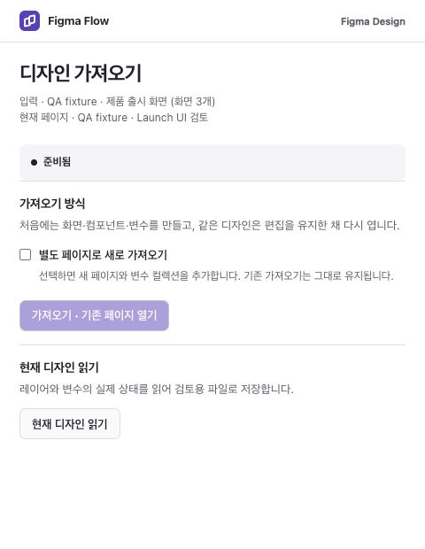

위 이미지는 생성 패키지의 HTML 미리보기입니다. 본제작의 실제 Figma 실행 결과를 대신하지 않습니다.


4. `prepare` 출력의 실제 `artifacts` 경로를 `IMPORT_ARTIFACTS`로 보관합니다. 현재 작업이 생성한 기대 계약과 같은 읽기 결과로 두 검사를 실행합니다. 예시 JSON은 프로젝트의 `production/production-readback.json`에 저장했다고 가정합니다.

```sh
"$PY" -B "$PLUGIN_ROOT/tools/figma_bridge.py" --inspect-readback production/production-readback.json \
  --input production/bundle/preview/resolved.json \
  --expected "$IMPORT_ARTIFACTS/expected-native-handoff.json" --require-match
"$PY" -B "$PLUGIN_ROOT/tools/native_handoff.py" --readback production/production-readback.json \
  --contract "$IMPORT_ARTIFACTS/expected-native-handoff.json" --out production/native-handoff
```

첫 검사는 종료 코드 0과 `matches_supplied_source: true`, 두 번째는 `report.json`의 `passed: true`를 확인합니다. `screen-spec.md`에서 실제 화면·조작·상태·토큰을 읽을 수 있습니다. 프로젝트 전체는 실제 앱·상태·테스트와 `bindings.json`을 연결한 뒤 `check_project.py --init --brief … --graph … --bindings … --out 새_검사_폴더`로 확인합니다. `summary.json`에서 신선도·네이티브 전달·디자인 검토를 각각 읽으세요. 게임 캠페인의 특정 생성 스킨·글자 길이 측정은 해당 프로젝트의 실제 지원 범위와 검증 자료를 별도로 확인합니다.

## 10. 그래프와 Figma 컴포넌트 동기화

전체 Figma 읽기 JSON을 역수입할 때도 현재 pairing의 그래프 마커를 대조합니다. 마커가 없거나 오래됐거나 두 형식이 충돌하면 그래프·웹 수정 전에 거절합니다. 해당 파일·페이지의 현재 값을 다시 읽고 정합 절차로 이어가며 JSON의 마커를 손으로 고치지 않습니다.

그래프 왕복은 지원되는 토큰·컴포넌트 속성과 선언된 네이티브/웹 연결 범위에 한정됩니다. 임의의 그림·전체 화면 레이아웃을 자동 양방향 재설계하지 않습니다. 로컬 변수/모드, 별칭, 컴포넌트 소비자와 실제 웹 값은 각각 현재 pairing 자료로 대조합니다. Figma 직접 편집은 역수입 후 그래프 정본을 갱신하고 웹을 다시 생성·측정해야 합니다.

컴포넌트의 디자인 값을 그래프 정본으로 관리하고 실제 Figma·웹과 왕복하려면 [Graph SSOT 명령 가이드](../examples/graph-ssot/README.md)를 사용합니다. 본제작의 사용자 선택과 실제 화면 검증은 계속 별도입니다.

1. 아래 [Graph SSOT 가이드](../examples/graph-ssot/README.md)의 `figma_workspace.py prepare --kind discover` 예제로 읽기 작업을 준비하고 홈에서 엽니다. **Figma 값 읽기** 패널의 페이지 범위를 확인한 뒤 **Figma 값 읽고 저장**을 누릅니다. `graph-native-discovery.json`이 다운로드됩니다. 생성·이관·값 변경은 실행하지 않습니다.

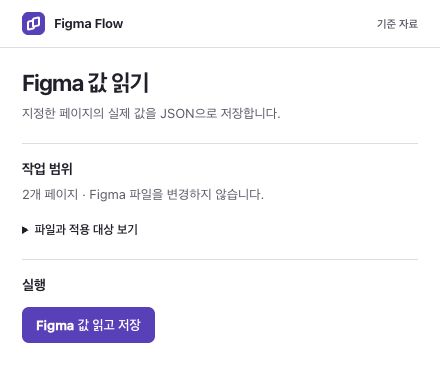

위 이미지는 생성된 읽기 전용 패키지의 HTML 미리보기입니다.

2. 실제 읽기 결과로 `prepare --kind sync --` 뒤에 `--adopt` 또는 기존 `--pairing` 옵션을 전달합니다. 홈에서 그 **그래프 동기화** 작업을 열어 **컴포넌트 동기화**로 들어갑니다. **Figma 값 읽고 저장**은 현재 상태만 읽습니다. **적용 범위 확인**도 쓰기 전 확인 단계이며, 토큰 변경·새 토큰·연결 조정과 영향을 받는 메인·인스턴스를 표시합니다.
3. 범위가 맞으면 **확인한 범위에 적용**을 누릅니다. **취소**는 확인창만 닫으며 적용하지 않습니다. 이미 시작한 적용을 되돌리는 버튼은 아닙니다. 실제 쓰기 이후에는 완료 또는 복구 상태를 기다립니다.
4. 완료 시 `graph-token-readback.json`이 자동 다운로드됩니다. 다운로드를 놓쳤으면 **JSON 다시 저장**을 누릅니다. 오류에서도 마지막 자료와 **실행 기록과 복구 정보**를 보관하세요. 이전 성공 자료를 현재 실행의 성공으로 사용하지 않습니다. 충돌은 실제 상태를 다시 읽고 새 계획으로 해결하며, 복구 충돌이 있으면 자동 재적용하지 않습니다.
5. 실제 웹 화면의 값을 읽고 `graph_sync.py pair`로 현재 네이티브·웹 결과를 대조합니다. Figma 완료 메시지만으로 웹 반영이나 디자인 승인을 판단하지 않습니다.

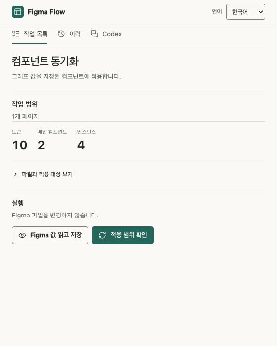

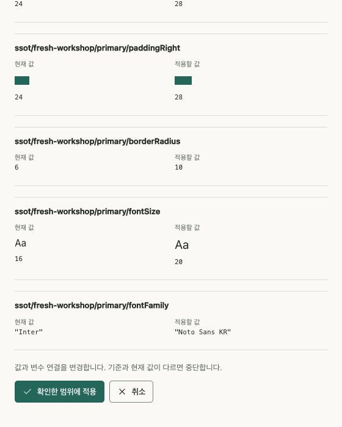

위 이미지는 실제 Figma에서 연 동기화 패널입니다. 파일 키 등 비공개 정보는 가렸습니다. 특정 프로젝트의 실행 장면이며 다른 프로젝트의 적용 성공을 보증하지 않습니다.

작업이 갱신되지 않으면 Codex 설치 버전만 확인하지 말고, 같은 작업 키의 revision과 고정 등록 경로를 대조하고 [작업을 재생성한 뒤 플러그인을 다시 실행](#updates)했는지 확인하세요.

<a id="multi-screen-web-proof"></a>

### 화면을 전환하며 웹 값 확인하기

0.25.0부터 현재 화면에 존재하는 컴포넌트만 지정해 읽고, 여러 화면의 실제 측정 파일을 합칠 수 있습니다. 확인 화면으로 이동해 입력 양식이 사라지는 앱이나 뷰포트별 컴포넌트에 사용합니다. 각 화면의 실제 상태를 만든 뒤 해당 컴포넌트의 probe를 실행하세요.

```sh
python3 tools/graph_sync.py probe --graph PROJECT/graph.json \
  --component desktopSubmit --out NEW/submit-probe.js
python3 tools/graph_sync.py probe --graph PROJECT/graph.json \
  --component desktopReturn --out NEW/return-probe.js
# 승인된 브라우저로 각 probe를 해당 화면에서 실행하고 실제 결과를 JSON으로 보관합니다.
python3 tools/graph_sync.py combine-web --graph PROJECT/graph.json \
  --proof ACTUAL_SUBMIT.json --proof ACTUAL_RETURN.json --out NEW/web-proof.json
```

컴포넌트 ID는 실제 그래프의 선언과 일치해야 합니다. 모바일 등 다른 선언도 있으면 모두 측정해 `--proof`로 추가합니다. `combine-web`은 전체 선언의 실제 측정이 모였을 때만 성공하며 그래프 해시·선택자·속성값·관측 시각·웹 주소·뷰포트를 검사합니다. 충돌하는 중복 측정은 거절합니다. 원본 JSON과 해시를 보존하고 `pair`에서 다시 확인하므로 원본 파일을 이동하거나 수정하지 마세요. JSON 객체와 브라우저가 한 번 문자열로 감싼 JSON을 지원합니다. JavaScript 객체 출력은 지원하지 않습니다.

합친 파일을 기존 `pair --web-proof`에 전달합니다. `--component`가 없는 probe와 최종 pairing은 계속 전체 선언을 요구합니다. 이 절차는 누락된 값을 예상값으로 채우거나 네이티브 검사를 대신하지 않습니다.

소수 픽셀은 최신 probe로 다시 측정합니다. 지원 브라우저에서는 Typed OM의 실제 픽셀 숫자를 읽어 CSS 문자열의 반올림 손실을 피합니다. 너비·높이는 기존 실제 사용값 경로를 유지하며, 숫자 검증은 원본 값 또는 그 값의 정확한 float32 표현만 인정합니다. 측정 파일의 값을 예상값으로 고쳐 맞추지 않습니다.

선언한 로컬 HTML의 입력 근거는 연결한 CSS의 중첩·인라인 `@import`와 사진·글꼴 `url()`도 추적합니다. 파일 부재·생성·변경·삭제를 반영하고 명시한 프로젝트 root 밖이나 symlink는 따라가지 않습니다. `requirements-optional.txt`의 CSS 파서가 필요하며 결과 v1·v2는 v3로 다시 준비합니다. 전체 CSS cascade·동적 JavaScript·외부 자산 수집이나 임의 HTML 가져오기를 뜻하지 않습니다. [CSS 간접 자산 예제](../examples/regression-program/html/css-assets/README.md)로 확인할 수 있습니다.

네이티브 시안의 아이콘 버튼은 `control_styles`에서 선택적으로 `justifyContent: "space-between"`을 지정할 수 있습니다. 기본값은 `center`입니다. 앞뒤 아이콘·라벨 순서, 양쪽 패딩, 최소 간격과 실제 끝점 배치를 검사합니다. 아이콘 없는 버튼의 `space-between`은 지원하지 않으며 준비 단계에서 거절합니다. 서로 다른 CSS 배치의 시안은 같은 HTML 구조를 재사용할 수 있지만, 실제 모바일·데스크톱 미리보기의 배치 차이는 계속 입증해야 합니다. 색상이나 이름만 바꾼 안은 독립 방향이 아닙니다.

양 끝 정렬의 원본 컴포넌트는 실측 `maxWidth`로 고정합니다. Figma는 HUG 너비에서 최소 아이콘 간격을 유지하지 않기 때문입니다. 투명 버튼은 `fill: null`로 명시하면 채우기와 색 변수 연결 없이 생성되며 실제 읽기에서도 빈 채우기를 요구합니다. `fill` 누락은 투명 지정이 아닙니다. 투명 버튼의 글자는 원래 배경의 합성 픽셀로 대비를 계산하며, 대비를 확정할 수 없는 경우는 계속 경고로 남습니다. 그래프 동기화의 `backgroundColor`는 불투명 RGB만 지원하므로 투명 버튼에는 해당 속성을 선언하지 않습니다.

<a id="readable-specifications"></a>

## 화면을 가리지 않는 스펙 설명

화면·버튼의 목적·조건·동작·결과·필요한 제한은 기존 graph annotation에서 가져옵니다. 원본에 없는 조건이나 기능을 만들지 않습니다. graph가 관계 정본이고 별도 브리프·명세가 사실의 정본이면 해당 위치·버전을 함께 연결합니다. 요구사항 → 화면/조작 → 인수 조건 → 검사 연결이 누락되면 새 전달을 미검증으로 남깁니다.

새 `direct`/`compare` 작성 경로에서는 실제 화면·버튼에 짧은 사람용 네이티브 어노테이션을 붙이고 **전체 스펙 보기**로 해당 설명 보드 항목을 연결합니다. 화면 밖의 Design 설명 보드는 목적·사용 조건·동작·결과·예외와 복구·사용 순서·Figma와 웹의 지원 범위를 원본에 있는 항목만 구분해 보여 줍니다. 보드에서 화면·버튼으로 돌아가는 링크도 함께 검증합니다. graph의 `summary`는 짧은 어노테이션, `platform_scope`는 매체별 차이를 설명하며, `specification_locale`은 `ko`·`en`·`ja` 중 브리프의 언어를 지정합니다. 요약을 전체 본문에 반복하거나 서로 다른 동작에 같은 제한 문구를 복사하지 않습니다.

0.26.0에서는 Figma에서 실행하지 않는 웹 버튼에도 같은 graph 스펙을 연결할 수 있습니다. `product_buttons`의 `specification_id`로 해당 화면의 action을 지정하고 실제 버튼 ID는 유지합니다. 읽기 검사는 연결된 설명과 컴포넌트 인스턴스를 확인하며, 이런 정적 버튼에는 실제 반응이 없어야 합니다. 여러 URL에서 시작하는 앱은 `draft_prototype.entry_states`에 실제 진입 상태를 선언할 수 있습니다. 두 뷰포트의 진입점·도달·복귀를 검사하며 화면 이동을 새로 만들어 주지는 않습니다. [작성 계약](../skills/figma-flow/references/graph-contract.md#native-draft-entries-and-static-controls)

`[figma-flow:…]`, 의미 ID·해시·소유권과 원래 주석 슬롯은 private 메타데이터에 보존합니다. 사용자 주석은 그대로 둡니다. private plugin data는 비밀 저장소가 아닙니다. 기존 prefix 문서는 정확한 소유권·변경 전 자료를 확인한 뒤 같은 노드와 보드 항목을 갱신합니다. 추적 prefix를 지우기만 하거나 전체 주석을 덮어쓰지 않습니다. 사람이 편집한 소유 어노테이션이나 중복 연결은 덮어쓰지 않고 충돌로 남깁니다.

```sh
# 텍스트 작업: graph와 같은 의미를 화면 명세로 내보냅니다.
"$PY" -B "$PLUGIN_ROOT/tools/specifications.py" export --graph "$PROJECT/graph.json" --out "$PROJECT/spec-export"
# 아래 계획도 로컬 파일만 생성합니다. CACHED_GETTER는 새로 읽었다는 뜻이 아닙니다.
"$PY" -B "$PLUGIN_ROOT/tools/specifications.py" plan --graph "$PROJECT/graph.json" \
  --readback "$CACHED_GETTER" --target "$NOTE_ID=$NATIVE_SEMANTIC_KEY" --out "$PROJECT/spec-plan.json"
```

실제 적용이 허용된 경우에만 기존 `native-edit` 작업의 `--plan`으로 준비·실행합니다. 변경 전 주석·메타데이터·보드 본문·대상 링크가 다르면 충돌로 남깁니다. graph를 바꾸면 계획을 다시 만들어야 하며, 이후의 실제 getter를 `specifications.py verify --graph … --plan … --readback …`와 대조합니다. 동일 입력은 중복을 만들지 않고, 실패 복구 중 사용자 편집을 발견하면 덮어쓰지 않습니다. 파일명이나 그럴듯한 설명만으로 최신 성공을 인정하지 않습니다.

공개 [Figma Plugin API](https://developers.figma.com/docs/plugins/api/Annotation/)는 Markdown 어노테이션을 지원합니다. 전역 **보기 → 주석** 표시를 제어하는 지원 API는 확인되지 않아 자동 숨김은 제공하지 않습니다. 기술 본문은 메타데이터로 분리하되 짧은 사람용 어노테이션의 대상 연결은 유지하고, 긴 스펙은 화면 밖에 둡니다. 네이티브 어노테이션을 보는 Dev Mode에는 계정·요금제 제한이 있을 수 있으며, 일반 Design 설명 보드는 별도로 사용할 수 있습니다. 사용자 주석 표시 설정을 바꾸지 않으며, 표시 켜짐/꺼짐과 네이티브 링크 클릭의 실제 UI 확인은 getter 검사와 구분합니다. [요구사항과 인수 조건](../specs/readable-specifications/spec.md)

<a id="prepared-native-edit"></a>

### 준비된 JSON으로 Figma 값 편집하기

`native-edit`는 그래프 동기화와 구분되는 작업 종류입니다. operation은 `read`와 `apply`이며, 허용한 JSON 계획을 플러그인 안의 Figma API로 실행합니다. 임의 JavaScript를 전달하지 않고 준비된 계획으로 실행합니다. 계획 준비만으로 Figma를 변경하지 않습니다.

예시는 ID와 값을 실제 getter 자료로 바꿔 사용합니다.

```json
{
  "schema": "figma-flow-native-edit-plan-v1",
  "file_key": "FILE",
  "page_id": "12:1",
  "edits": [
    {"node_id": "12:3", "main_id": "12:2", "field": "fontSize", "before": 18, "after": 20}
  ]
}
```

현재 노드 편집은 로컬 메인 컴포넌트와 그 안의 명시된 텍스트를 대상으로 하며 `fontSize`, `fontFamily`, `paddingLeft`, `paddingRight`, `backgroundColor`, `color`, `borderRadius`를 지원합니다. 텍스트에는 `main_id`를 지정하고 한 트랜잭션에서 같은 텍스트의 글꼴 변경은 하나만 선언합니다. 노드 편집은 1–32개, 계획 JSON은 최대 128,000바이트입니다. `edits` 대신 `variableedit: {variable_id, mode_id, before, after}`로 해당 페이지에서 사용하는 로컬 변수의 한 모드 값을 준비할 수도 있습니다. 같은 변수의 연결된 소비자는 그 값을 함께 사용합니다.

```sh
"$PY" -B "$PLUGIN_ROOT/tools/figma_workspace.py" prepare --workspace "$WORKSPACE" \
  --key selected-font-edit --title "선택한 컴포넌트 글자 크기" --project "내 프로젝트" \
  --kind native-edit -- --plan "$PROJECT/native-edit.json"
"$PY" -B "$PLUGIN_ROOT/tools/figma_control.py" run --workspace "$WORKSPACE" \
  --key selected-font-edit --operation apply --file-key "$FILE_KEY" --page-id "$PAGE_ID" \
  --expected-revision "$REVISION" --timeout 120
```

정확한 파일·페이지·노드/변수·모드·현재 revision과 실제 `before` 값이 일치해야 적용합니다. 반환 자료의 `native_edit.plan_sha256`, `applied`, 실제 전후 값을 확인하고, 실패 시 복구 자료와 충돌을 보존합니다. 결과가 `uncertain`이면 쓰기를 자동 재시도하지 않고 현재 범위를 다시 읽어 복구합니다. `native-edit`는 Figma 값을 먼저 편집하므로 그래프 정본 반영은 아래 [직접 편집 역수입 절차](../examples/graph-ssot/README.md#designer-edits-to-graph)로 별도 수행합니다. 새 리비전 준비·재시작·수동 JSON 대체 경로는 다른 작업과 같습니다.

## 11. 작업을 준비한 Codex 채팅으로 연결

홈의 작업 옆 또는 실행이 끝난 작업 상단의 **Codex 연결**을 누릅니다. 대상은 그 작업에 기록된 원래 thread ID입니다. 화면 전환 시 입력은 초기화되므로 저장할 결과는 먼저 보관하세요. 현재 데스크톱에서 앞에 떠 있는 채팅을 추정해 전송하지 않습니다. 오프라인 작업에 thread가 없으면 연결 버튼은 비활성입니다.

1. 선택한 Figma 노드에 대한 요청을 적고 **보낼 내용 확인**을 누릅니다. 노드를 포함하면 요청 문장은 생략할 수 있고, 선택이 없으면 요청이 필요합니다. **현재 선택한 노드 포함**은 ID·이름·종류·위치·크기와 파일/페이지 링크를 미리보기에 담습니다. 전체 페이지를 순회하거나 이미지·전체 문서를 자동 첨부하지 않습니다.
2. 선택 노드는 최대 20개입니다. 텍스트는 기본 제외되며 **선택한 텍스트 일부 포함**을 직접 선택할 때만 노드당 200자·합계 1000자 이내를 넣습니다. 이름·문구·링크도 공개해도 되는지 **실제로 전달할 내용**을 확인합니다.
3. 기본 경로는 **내용 복사 → 링크로 채팅 열기 → 직접 붙여 넣기·전송**입니다. 복사가 차단되면 선택된 미리보기 내용을 복사 단축키로 보관합니다. 링크는 원래 채팅을 여는 요청이며 메시지를 자동 전송하지 않습니다.
4. 로컬 relay를 설정했다면 **채팅 열기**와 **채팅에 보내기**도 사용할 수 있습니다. 보내기는 확인한 미리보기와 같은 텍스트를 해당 채팅의 대기열에 넣습니다. **채팅 대기열에 추가했습니다**는 에이전트가 읽거나 실행했다는 뜻이 아닙니다. Codex에서 실제 접수와 다음 작업을 확인하세요.

선택적 relay는 작업공간을 준비·갱신하는 지원 POSIX 환경에서 다음과 같이 설정합니다. `43179`는 예시 포트이며 기존 작업공간에 다른 포트가 있으면 그 설정을 확인해 사용합니다. 고정 manifest를 다시 실행해야 추가된 연결 설정을 읽습니다.

```sh
"$PY" -B "$PLUGIN_ROOT/tools/figma_workspace.py" init \
  --workspace "$WORKSPACE" --id-from "$WORKSPACE/manifest.json" --chat-port 43179
"$PY" -B "$PLUGIN_ROOT/tools/workspace_chat.py" --workspace "$WORKSPACE"
```

relay를 실행하지 않아도 복사·명시적 링크 열기는 가능합니다. relay는 비공개 작업공간의 작업·thread·revision과 인증을 대조합니다. 직접 큐 전송에는 `PATH`의 공식 Codex CLI가 필요하며, Windows에서 relay를 별도로 사용하는 경우 native `codex.exe`가 필요합니다. 비밀값이 든 작업공간을 공개 ZIP·Git·지원 로그로 공유하지 않습니다. 접수 여부가 불확실하면 원래 채팅을 먼저 확인하고 같은 요청을 자동 재전송하지 않습니다.

공식 동작은 [Codex 앱 명령과 채팅 링크](https://learn.chatgpt.com/docs/app/commands), [Codex CLI `queue`](https://learn.chatgpt.com/docs/cli/reference#codex-queue)를 참고하세요. 이 연결이 Figma 적용·디자인 선택·후속 실행의 승인을 대신하지 않습니다.

디자인 비평의 출처와 각색 범위는 [Unslop attribution](../README.md#라이선스와-참고)을 참고하세요.

## 막힌 위치 찾기

| 보이는 현상 | 확인할 위치와 다음 행동 |
|---|---|
| Codex에서 플러그인이 보이지 않음 | `codex plugin list --marketplace figma-flow-local`에서 설치 경로·버전·활성 여부를 확인하고 새 Codex 채팅을 엽니다. |
| Figma에서 manifest 오류, 다른 작업이 열림 | 고정 `WORKSPACE/manifest.json`의 실제 등록 경로·ID와 홈의 프로젝트·작업 키를 확인합니다. 개별 작업 manifest 등록은 standalone 호환용입니다. |
| 품질 검사에서 패키지 생성 중단 | `design-quality.json`의 오류가 지목한 레이어·버튼·폰트를 고친 다음 원본과 검토 패킷을 다시 생성합니다. |
| 임베드 에셋 용량 경고 | base64 합계가 4 MB를 넘었다는 뜻입니다. 생성된 ZIP은 사용할 수 있습니다. 줄일 경우 원본이 달라지므로 다시 패키징·검증합니다. |
| 저장 버튼이 없거나 비활성 | 가져오기는 읽기가 끝나면 **JSON 파일 저장**이 나타납니다. 검토는 시안 생성 또는 진단 자료가 필요합니다. 그래프 패널은 읽기·적용 후 **JSON 다시 저장**을 사용합니다. |
| 열기 대신 다른 파일로 표시됨 | 홈에 표시된 지정 Design 파일에서 같은 Figma Flow를 다시 엽니다. 파일 범위를 임의로 바꾸지 않습니다. |
| 대화 미연결 또는 전송 비활성 | 실제 원래 thread ID와 선택적 relay 연결을 확인합니다. thread가 없는 오프라인 작업은 그대로 사용할 수 있고, 자동 추정하지 않습니다. |
| 업데이트했는데 예전 작업이 보임 | 새 설치본으로 같은 작업 키를 갱신하고 `list`의 revision·고정 등록 경로를 확인합니다. 열린 플러그인 창을 닫고 다시 실행합니다. |
| 페이지 부족, 끊긴 연결 | 편집 가능한 여유 페이지와 연결 상태를 확인한 다음 대상에 맞게 다시 실행합니다. 기존 페이지·파일을 삭제할 필요는 없습니다. |
| 검사 결과가 stale 또는 blocked | `freshness_unverified`의 노드·사유·누락 파일과 개별 검사 영수증을 확인합니다. 실제 원본·근거를 보완하고 새 출력 폴더에서 다시 검사합니다. |

<a id="browser-access"></a>

## Figma Flow 브라우저 접근

Figma Flow가 사용하는 격리 브라우저에서는 `localhost`와 `127.0.0.1`을 항상 허용하고, Figma Flow 작업에 사용하는 외부 페이지도 자동 승인합니다. 이 범위에서는 URL별 승인 요청 없이 자료 확인·로컬 미리보기 검증을 진행합니다. 다른 브라우저나 전역 Stagehand 설정을 바꾸는 정책은 아닙니다. 현재 작업 프로젝트 루트에서 전용 설정을 생성합니다.

```sh
"$PY" -B "$PLUGIN_ROOT/tools/browser_access.py" --config .figma-flow/playwright-mcp.json --auto-allow
```

생성한 설정을 전용 `figma_flow_browser` MCP에 연결하고 실제 적용을 확인합니다. 생성만으로 브라우저 연결 성공을 주장하지 않습니다. [도구별 등록과 적용 확인](../skills/figma-flow/references/browser-access.md)을 따릅니다.

<a id="setup-prompt"></a>

## 설치를 Codex에 맡기는 짧은 프롬프트

빈 폴더 또는 기존 클론의 새 Codex 채팅에서 복사해 사용합니다. 첫 설치 전에는 스킬이 아직 없으므로 일반 요청으로 시작합니다.

```text
Figma Flow v0.26.2을 설치하고 실제 Figma 연결 테스트까지 진행해 줘.
저장소는 https://github.com/jonsoku-dev/figma-flow.git이고 정본 안내는 docs/guide.md야.
기존 작업·설치·작업공간 ID를 보존하고, 실제 installedPath와 버전을 확인한 뒤 설치된 figma-plugin-setup 스킬로 이어가.
CLI·파일 작업은 네가 하고 Figma Flow 최초 등록과 실행은 내가 할게. 실행 세션마다 한 번 연 뒤 localhost 제어로 진행해.
회사 npm이 필요할 때만 정확한 HTTPS URL과 전체 미러/스코프를 확인하고 인증값은 요청하지 마.
실제 readback으로 검증하고 미관찰 항목은 미확인으로 남겨. 구체적인 요청은 한 안으로 진행하고, 비교를 요청한 경우 후보를 보여 준 뒤 내 실제 선택을 기다려.
```

설치 후 스킬이 보이지 않으면 새 채팅에서 `$figma-plugin-setup`과 실제 설치 경로·버전·프로젝트·Python·workspace·완료 단계를 전달합니다. 개발자는 별도로 허용된 Computer Use로 테스트할 수 있으며 소비자의 필수 설치 요소는 아닙니다.

<a id="environment"></a>

## Node·Python·회사 npm 환경

Node는 저장소 `.nvmrc`의 정확한 버전을 사용합니다. macOS/Linux의 nvm에서는 `nvm install` → `nvm use` → `node --version`으로 확인합니다. Windows의 설치 프로그램이나 nvm-windows에는 `.nvmrc` 값을 직접 지정합니다. Python 가상환경과 의존성은 위 첫 예제 절차를 사용합니다. 저장소 루트에는 `package.json`이 없으므로 루트에서 `npm install`·`npm ci`를 실행하지 않습니다. 패널 개발은 [전용 개발 안내](../panel-ui/README.md)를 따릅니다.

회사 레지스트리가 필요 없으면 기존 설정을 유지합니다. 필요하면 관리자가 제공한 **전체 HTTPS URL(서비스 경로 포함)**과 전체 패키지 미러인지 특정 `@scope`인지 확인합니다. 도메인에서 경로를 추측하지 않습니다. URL에 사용자 정보·쿼리·프래그먼트·공백·제어 문자를 넣지 않습니다. 기존 프로젝트 `.npmrc`를 비공개 위치에 백업하고 다른 키·주석을 보존한 뒤 필요한 키만 설정합니다.

```sh
# 전체 미러일 때만
npm config set --location=project registry "$REGISTRY_URL"
# 특정 스코프일 때만. 전체 미러 설정과 임의로 함께 실행하지 않습니다.
npm config set --location=project "$REGISTRY_SCOPE:registry" "$REGISTRY_URL"
npm config get registry
npm config get package-lock
npm ping --registry="$REGISTRY_URL"
```

인증은 `npm login --registry="$REGISTRY_URL"`로 사용자 설정이나 회사 승인 자격 증명 도구에 저장합니다. 스코프가 있으면 `--scope="$REGISTRY_SCOPE"`를 추가합니다. 토큰·비밀번호를 프롬프트·명령 인자·프로젝트 `.npmrc`·Git에 넣지 않습니다. 회사 CA는 승인된 파일을 `npm config set cafile "/absolute/path/company-ca.pem" --location=user`로 설정하며 TLS 검증을 끄지 않습니다. 사용자 `.npmrc` 전체를 로그에 출력하지 않습니다.

프로젝트 `.npmrc`의 `package-lock=false`와 `.gitignore`의 lockfile 제외를 유지합니다. `git ls-files '*lock*'`와 `git diff --cached --name-only`로 실제 패키지 매니저 잠금 파일을 확인합니다. `blocks.py` 같은 일반 소스를 혼동하지 않습니다. 이미 추적 중이면 정확한 lockfile 경로만 `git rm --cached -- PATH`로 로컬 파일을 보존하며 제외합니다. 과거 이력은 그대로 남으므로 새 private 배포에 이력이 필요 없으면 아래 스냅샷 방식을 씁니다. pnpm·Yarn·Bun 생성 옵션은 npm 설정과 별도입니다. 잠금 파일을 제외하면 간접 의존성 해석이 달라질 수 있으므로 실제 도구 버전과 검증 결과를 남깁니다. [npm 설정·인증 범위](https://docs.npmjs.com/files/npmrc/)

<a id="automatic-startup"></a>

## 매번 시작할 때 최신 플러그인 확인

Codex 작업 시작마다 두 플러그인의 상태를 함께 확인합니다. 등록된 원본의 최신 안정 태그와 실제 설치 파일을 대조한 뒤 안전한 경우 Codex 패키지와 Figma 실행 파일·준비된 작업을 갱신합니다. 이 자동 확인·단일안·사람용 스펙 경로는 0.26.0에 포함됩니다. 기존 설치는 실제 설치 파일과 실행본을 확인한 뒤 갱신합니다. Codex 앱이나 Figma 앱의 버전을 바꾸는 기능은 아닙니다. 아래 명령의 `PLUGIN_ROOT`는 현재 호스트가 반환한 실제 설치 경로입니다.

```sh
# Figma 작업이 허용된 세션
"$PY" -B "$PLUGIN_ROOT/tools/plugin_startup.py" ensure \
  --figma-access allowed --workspace "$WORKSPACE"
# 로컬/텍스트 전용 또는 Figma 접근이 금지된 세션
"$PY" -B "$PLUGIN_ROOT/tools/plugin_startup.py" ensure --figma-access forbidden
# 설치를 바꾸지 않는 점검은 ensure 대신 check
```

버전 고정, 개발 체크아웃·사용자 변경, 출처 불명, 공유 marketplace, 오프라인·인증 실패, 실행 중이거나 결과가 불확실한 작업, 변경된 입력은 예외로 남깁니다. 사내 복제본을 공개 upstream으로 바꾸지 않습니다. `--authority`는 확인한 원래 출처가 있을 때만 지정합니다. 정상 업데이트는 제거 전에 이전 설치의 독립적인 복구 사본을 검증합니다. 등록할 릴리스와 복구 사본은 임시 폴더 밖의 사용자 전용 영구 상태 폴더에 보관하며, 일반 임시 폴더 정리로 지워지지 않습니다. 실패하면 원래 바이트를 복원하고 예외를 보고합니다. Git 등록의 복구에 로컬 사본을 사용하면 그 변경과 원래 authority/SHA를 기록합니다. 복구 근거가 없으면 제거 전에 중단합니다.

Codex 갱신 결과가 `current` 또는 `updated`일 때만 Figma 파일 갱신을 진행합니다. `--figma-access forbidden`은 Figma 작업공간·연결·읽기·갱신을 실행하지 않습니다. 성공 후에는 반환한 실제 설치 경로에서 다음 명령을 실행합니다. 파일이 최신이어도 열린 Figma 플러그인이 최신이라는 뜻은 아닙니다. 같은 고정 플러그인을 다시 열고 인증된 실행 버전·코드 해시·generation을 확인합니다. 오래되었거나 버전을 보내지 않는 실행기는 쓰기를 거부합니다. 실제 실행 확인 전에는 `loaded: unverified`로 남깁니다.

<a id="updates"></a>

## 업데이트와 되돌리기

1. `plugin list`·`marketplace list`의 소스·설치 경로·버전·활성과 workspace 전체(숨김 `.generations` 포함), 고정 manifest·ID·등록 경로, 작업 키/revision, 실제 Figma 페이지·선택·읽기 자료를 보존합니다. 캐시 경로만으로는 재설치 가능한 롤백 사본이 되지 않으므로 이전의 깨끗한 소스와 태그도 확보합니다.
2. [변경 기록](../CHANGELOG.md)과 실제 정식 릴리스 또는 지정한 회사 릴리스를 확인하고 새 전용 클론에 받습니다. `main`이나 태그 문자열 정렬을 최신 배포판으로 간주하지 않습니다. 기존 작업에서 강제 checkout·reset·stash를 하지 않습니다.
3. 현재 `codex plugin ... --help`를 확인해 정확한 소스만 갱신합니다. `marketplace upgrade NAME`은 소스 갱신이며 설치 캐시 교체를 보장하지 않습니다. 태그를 바꿀 때는 새 클론을 등록하거나 지원되는 ref 변경 절차를 사용합니다. 이전 소스를 기록하고 필요하면 해당 marketplace만 remove/add합니다. 새 소스와 롤백 수단을 준비한 뒤 해당 플러그인만 재설치합니다.

```sh
codex plugin remove "figma-flow@$MARKETPLACE" --json
codex plugin add "figma-flow@$MARKETPLACE" --json
codex plugin list --marketplace "$MARKETPLACE" --json
```

4. 새 `installedPath`·활성·소스와 설치 복사본의 두 매니페스트 버전을 대조하고 `PLUGIN_ROOT`를 새 설치 경로로 바꿉니다. 새 채팅에서 새 스킬을 읽습니다. 지원하지 않는 `codex plugin update`나 캐시 수동 삭제를 사용하지 않습니다.
5. **실행 중인 기존 `figma_control.py serve`를 그 서비스 터미널에서 정상 종료하고 새 설치본의 도구로 다시 시작합니다.** 설치 교체만으로 메모리에 남은 이전 서비스가 갱신되지 않습니다. 다른 프로젝트의 프로세스를 종료하지 않습니다. 작업 중인 쓰기는 먼저 완료 여부를 확인합니다.
6. 새 설치본으로 같은 작업 키를 `prepare`하고 변경 입력에는 `list`의 현재 revision을 `--replace-expected REVISION`으로 전달합니다. 제어 설정은 유지하며 `refresh`로 workspace를 게시합니다. 고정 ID와 등록 manifest는 유지합니다.

```sh
"$PY" -B "$PLUGIN_ROOT/tools/figma_workspace.py" refresh --workspace "$WORKSPACE"
"$PY" -B "$PLUGIN_ROOT/tools/figma_control.py" serve --workspace "$WORKSPACE"
```

7. 사용자가 Figma Flow를 열고 현재 revision을 확인합니다. 예전 코드·목록이면 창을 닫고 **같은 고정 플러그인**을 다시 실행합니다. 자동 재로드·영구 무재시작을 보장하지 않습니다. 실제 새 JSON으로 작업별 검증을 다시 수행합니다. 목록 갱신만으로 실행 성공을 주장하지 않습니다.
8. 실패하면 새 진단과 복구 충돌을 보관합니다. 이전 소스에서 재설치하고 이전 workspace **전체**를 복원하며 서비스도 해당 설치본으로 다시 시작합니다. 실제 Figma 사용자 변경·페이지를 자동 삭제하거나 강제 덮어쓰지 않습니다. 결과 불명 쓰기는 현재 범위를 다시 읽고 해결합니다.

선택적 paired sync는 기존 상태·인증·페이지·키·baseline 체인을 보존하고 새 전용 상태에서 확인합니다. 새 JSON을 과거 성공 자료로 대체하지 않습니다. 예전 개발 플러그인 등록 정리는 새 연결 검증 후 해당 등록만 대상으로 합니다. 원래 ID·manifest 경로·전체 패키지를 복원 가능하게 보관하고, 다른 ID의 private data를 새 ID로 자동 이관하지 않습니다.

원본 graph나 검증된 manifest를 바꾼 뒤 이전 준비 작업이 새 목록 게시를 막으면, `list`의 정확한 키·revision을 선택해 이전 작업을 퇴역시킬 수 있습니다. 다음 선택 파일의 revision은 실제 값으로 바꿉니다.

```json
{"schema":"figma-flow-workspace-retirement-v1","tasks":[{"key":"obsolete-review","revision":"CURRENT_REVISION_SHA256"}]}
```

```sh
"$PY" -B "$PLUGIN_ROOT/tools/figma_workspace.py" retire --workspace "$WORKSPACE" --tasks "$RETIRE_SELECTION"
```

선택 전체를 확인한 뒤 활성 목록에서만 제외하고 비공개 `.retired`에 복구 기록을 남깁니다. 실제 디자인·작업 파일·이전 세대·영수증은 유지합니다. 실행 중이거나 변경 결과가 불확실하면 먼저 확인해야 하며, 원본을 과거 바이트로 되돌려 검사를 통과시키지 않습니다. 다시 사용할 작업은 현재 입력으로 새로 준비합니다. 큰 스펙 갱신 계획은 128,000바이트 한도 안에서 나누고, 다음 계획은 직전 실행 후 새로 읽은 자료로 만듭니다.

<a id="paired-receivers"></a>

### 기존 paired 동기화와 검토 수신기

처음 설치·검토에는 `serve_figma_sync.py`가 필요하지 않습니다. 사용 중인 경우에만 [토큰 동기화 계약](../skills/figma-flow/references/token-sync.md)과 [브리지의 paired companion 안내](../figma-bridge/README.md)를 읽습니다. 상태 폴더에는 pairing 비밀값이 있으므로 Git·공유 ZIP·지원 로그에 넣지 않습니다.

진행 중인 동기화 서버의 PID·프로젝트·상태 폴더를 확인한 뒤 그 서버만 종료합니다. 새 코드가 상태 폴더 안의 기존 플러그인 변경을 거부하면 **새 private 상태 디렉터리**로 새 컴패니언을 만들고 기존 체인을 보존합니다. `--prior-sync`는 아무 읽기 파일을 받는 일반 업그레이드 옵션이 아니며, 도구가 명시적으로 지원하는 이전 성공 apply wrapper에만 사용합니다. 예전 pairing 키로 다른 파일·페이지를 연결하지 않습니다.

같은 ID의 기존 paired state가 있으면 작업공간에 `prepare --kind import -- --input ORIGINAL_RESOLVED --reviewed-sha256 ACTUAL_SHA --paired-state PRIVATE_STATE`로 준비할 수 있습니다. 해당 서버는 실행 중이어야 하며 파일·페이지·원본 해시·ID가 정확히 같아야 합니다. 다른 ID의 상태는 거부하며 ID만 바꾸지 않습니다. 사용자는 홈에서 작업을 열어 **앱에 반영**을 수행하고 실제 결과를 전달합니다. 기존 standalone 컴패니언 등록은 호환 경로로 유지합니다. Codex는 같은 파일/page/원본·인증·저널 검증을 수행합니다. 일반 검토 플러그인 업데이트만을 위해 로컬 서버나 네트워크 권한을 추가하지 않습니다.

검토 시안의 인증된 `/draft-readback` 수신기를 쓰던 프로젝트도 별도 분기입니다. 일반 검토 작업은 JSON 저장만으로 검증할 수 있으며 수신기가 필수는 아닙니다. 자동 전달을 유지하려면 사용자 소유 0700 `REVIEW_PAIR` 폴더를 먼저 준비하고 다음처럼 명시합니다. 포트는 양쪽이 같아야 하며 실제 대상 파일을 고정합니다.

```sh
REVIEW_PAIR="/내/비공개/검토수신기"
# 처음 사용할 새 경로에만 생성합니다. 기존 private 폴더가 있으면 보존·검사합니다.
mkdir -m 700 "$REVIEW_PAIR"
"$PY" -B "$PLUGIN_ROOT/tools/figma_workspace.py" prepare \
  --workspace "$WORKSPACE" --key workshop-review-paired --title "워크숍 검토와 수신 확인" \
  --project "워크숍" --kind review -- \
  --manifest "$PROJECT/review/directions.json" --file-key ACTUAL_FILE_KEY \
  --pair-dir "$REVIEW_PAIR" --receiver-port 49185
# REVIEW_ARTIFACTS에는 위 prepare 출력의 artifacts 경로를 넣습니다.
"$PY" -B "$PLUGIN_ROOT/tools/figma_draft.py" serve \
  --packet "$REVIEW_ARTIFACTS/packet.json" --out "$PROJECT/received-review" \
  --pair-dir "$REVIEW_PAIR" --port 49185
```

capability는 비공개 폴더에서 생성·재사용되며 공개하지 않습니다. 수신기의 성공·거부 영수증과 수신기 중단 시 **결과 JSON 저장** 수동 경로를 각각 확인하세요. 거부 영수증은 **상세 진단 보기**에서 사유를 확인합니다. 이 전달은 앱 반영 `/sync` 또는 원래 채팅 relay와 다른 동작이며, 기존 등록을 없애기 전에 필요한 경로를 실제로 대조합니다.

<a id="private-distribution"></a>

## 회사 private 저장소 배포

공개 저장소의 GitHub fork를 private 배포로 간주하지 않습니다. 별도의 빈 private 저장소를 사용하고 각 설치 머신의 실제 Git HTTPS/SSH 인증으로 읽기 권한을 확인합니다. GitHub 커넥터·`gh` 로그인과 로컬 Git 인증은 별개일 수 있습니다. 조직 SSO와 계정 로그인은 사용자가 수행하며 인증값을 URL에 넣지 않습니다.

이력이 필요 없으면 검증한 릴리스를 새 전용 폴더에 클론하고 `git archive` 스냅샷을 다른 새 폴더에 풀어 사용합니다. 원본 URL·태그·정확한 커밋을 기록하고 MIT `LICENSE`, 외부 스킬 원문·저작권·라이선스를 유지합니다. 회사 변경은 별도 릴리스로 구분합니다. `.agents/plugins/marketplace.json`의 최상위 `name`만 회사 고유 이름으로 바꾸고 plugin 이름 `figma-flow`와 `source.path: ./`는 유지합니다. 설치 선택자는 `figma-flow@회사-마켓플레이스`입니다.

```sh
# 이미 검증한 SOURCE_DIR과 비어 있는 새 PRIVATE_DIR을 사용합니다.
git -C "$SOURCE_DIR" archive --format=tar --output="$PRIVATE_DIR/release.tar" HEAD
tar -xf "$PRIVATE_DIR/release.tar" -C "$PRIVATE_DIR"
```

방금 만든 임시 아카이브를 배포 파일에 포함하지 않습니다. 회사 npm 범위·lockfile 제외를 확인하고 인증값, 실제 Figma 읽기 결과·선택 대화·비공개 workspace가 포함되지 않도록 검사합니다. 이력이 필요하면 별도 클론에서 필요한 브랜치/태그와 과거 비밀값·lockfile·LFS·배포 권리를 검토합니다. 기본 배포에 전체 mirror push는 필요하지 않습니다.

원격 생성·push는 현재 사용자에게 실제 소유자/저장소와 업로드 권한이 있을 때 수행합니다. `gh repo view OWNER/REPO --json nameWithOwner,visibility,url`의 `PRIVATE`와 `git remote -v`의 정확한 목적지를 확인합니다. 기존 원격을 강제 덮어쓰지 않습니다. 설치 머신에서는 회사 소스를 새 전용 클론에 받아 위 설치 절차의 실제 marketplace 이름으로 설치합니다. 직접 Git 등록을 지원하는 CLI는 `codex plugin marketplace add URL --ref TAG --json`도 사용할 수 있습니다.

회사 최신화는 원본 릴리스 비교 → 회사 변경 통합·검증 → 회사 릴리스 → 팀원 Codex 설치 → 기존 서비스 교체·workspace 재준비·실제 읽기 검증 순서입니다. 스냅샷은 원본 Git 이력을 공유하지 않으므로 `merge upstream/main` 대신 새 스냅샷과 회사 변경을 비교합니다. 이 문서는 배포 절차이며 실제 원격 생성이나 업로드를 실행하지 않습니다.

<a id="english"></a>

## English quick start

At each workflow start, check and safely update both plugin packages/runtime files from the exact registered source. Pins, active work, unknown source, offline/auth failures and forbidden Figma access are explicit exceptions; actual loaded runtime remains separately verified. A concrete direction uses one `direct` draft; `compare` is for requested alternatives. Human specifications come from graph meaning and appear outside artwork, with technical ownership retained separately. [Startup](#automatic-startup) · [Readable specifications](#readable-specifications) · [Direction contract](../skills/figma-flow/references/direction-selection.md).

Version 0.24.1 checks the running local server before queueing every run, including --no-wait. Restart only this workspace's service with the current installed tools if the version, implementation or capability check fails. Full native discovery imports must match the pairing marker before writing graph or web files.

Wait for native runs to finish before preparing or refreshing that workspace. A claimed request blocks new publication so an automatic Desktop reload cannot interrupt that known active run. Uncertain operations require a current read before retrying. This does not make all reload timing atomic.

[한국어](#korean) · [日本語](#japanese)

Computer Use and official Figma MCP are not required for consumer operation. Developers may use separately authorized Computer Use for verification. Register **one Figma Flow development plugin**. Launch it manually in the target Figma Design file once per plugin session. Codex can then run prepared operations through private localhost control without repeated button clicks. A closed plugin must be reopened; updates may also require reopening. There is no hidden background launcher or arbitrary remote code evaluation.

## Fonts without Computer Use

Set the family and style in the design source, for example **Hahmlet Bold** for a title and **Noto Sans KR Regular** for body copy. Open Figma Flow in the target file. During draft creation the plugin checks Figma’s available fonts and loads each required style. A missing style stops draft creation before a page is created. Use an organization-approved font or update the design source and prepare it again. A font bundled with the website needs to be available separately in Figma.

Codex can retrieve the result while local control is connected. For offline work or a connection failure, use **Create drafts** and the JSON download in the review panel, then give Codex that file to compare the actual font families and styles.

## Install once

```sh
git clone --branch v0.26.2 https://github.com/jonsoku-dev/figma-flow.git
cd figma-flow
codex plugin marketplace add "$PWD"
codex plugin add figma-flow@figma-flow-local
codex plugin list --marketplace figma-flow-local
```

Check the actual `installedPath` returned by `plugin add --json` and both plugin manifests are `0.26.2`. Run the following commands from that installed root with the project Python environment containing `requirements-optional.txt`. Workspace preparation currently supports POSIX hosts, including macOS/Linux; retain standalone compatibility on unsupported hosts. Logins and desktop access approvals remain user actions.

Reuse your workspace if it exists. Otherwise obtain your own ID in Figma Desktop through **Plugins → Development → New plugin → Figma Design → Custom UI**, then initialize a private workspace:

```sh
python3 tools/figma_workspace.py init --workspace PRIVATE_DIR --id-from OWN_MANIFEST.json
python3 tools/figma_workspace.py prepare --workspace PRIVATE_DIR \
  --key invite-discovery --title "Invite baseline" --project "Invite" --kind discover -- \
  --file-key FILE --page-id PAGE
```

Replace placeholders with actual paths and native scope. Register only `PRIVATE_DIR/manifest.json`. Keep the complete private directory, including hidden generations. Private plugin data is tied to its original Figma plugin ID; changing an ID does not migrate ownership. [Full identity and migration guidance](#5-고정-작업공간-등록과-검토-작업-준비).

## Let Codex run prepared work

```sh
python3 tools/figma_control.py enable --workspace PRIVATE_DIR --port 43180
python3 tools/figma_workspace.py refresh --workspace PRIVATE_DIR
python3 tools/figma_control.py serve --workspace PRIVATE_DIR
```

Keep the service running, then manually launch **Figma Flow** in the correct file. From a separate Codex CLI execution:

```sh
python3 tools/figma_control.py run --workspace PRIVATE_DIR --key invite-discovery \
  --operation read --file-key FILE --page-id PAGE --expected-revision REVISION --timeout 120
python3 tools/figma_control.py status --workspace PRIVATE_DIR --id OPERATION_ID
```

Use the actual current revision from `figma_workspace.py list`. The service and Figma Desktop use the same computer's localhost. `--focus-page` can focus only the exact signed task page in the current file. `--no-wait` acknowledges a request, so inspect its status afterward.

| Prepared kind | Operation |
|---|---|
| `review` | `create` |
| `import` | `import`, `read`; `sync` only with admitted paired app state |
| `discover` | `read` |
| `sync` | `read`, `apply` |
| `native-edit` | `read`, `apply` |

Verify the returned `readback` artifact with the normal checker. Direction review uses `verify-native-review`; selected rich production uses `verify-production`; structured imports use `--require-match` and `native_handoff.py`; graph sync also needs actual web proof and `pair`. An `ok` receipt does not approve a design or prove browser parity. Preserve failed/expired/uncertain receipts. Re-read native state before retrying an uncertain write. Human direction selection remains separate.

An interrupted same-packet review reservation or owned board blocks a new duplicate page and identifies the existing page. Read its actual state and preserve node IDs and user edits. The bounded specification-edit path can repair missing specs, annotations and board links; it does not rewrite an old receipt as success or restore creation-completion metadata.

Changed tasks use `prepare --replace-expected CURRENT_REVISION`. `prepare` or `refresh` publishes updated metadata. Desktop auto-reload behavior varies: if the running revision is old, reopen the same plugin rather than re-registering another manifest.

## Selected rich production and contrast

Codex can produce the single user-selected direction on a **PRODUCTION** page while preserving reviewed art, layout and behavior. The layout uses `figma-flow-authored-native-production-v1`, `scope: selected-production` and `sourceSelection` pins. Its `figma-flow-selected-production-change-v1` request pins the selection, reviewed/production layouts, graph, actual managed user directive and exact before/after changes. Supported categories are authorized `contrast` and `sync`; sync is not permission to redesign.

```sh
python3 tools/figma_workspace.py prepare --workspace PRIVATE_DIR --key selected-production \
  --title "Selected production" --project "My project" --kind review -- \
  --selection PROJECT/review/selection.json --layout PROJECT/production/native-layout.json \
  --product-graph PROJECT/production/graph.json --change-request PROJECT/production/change-request.json \
  --file-key FILE
python3 tools/figma_draft.py verify-production --packet ARTIFACTS/packet.json --readback ACTUAL.json
```

Run local control `--operation create` with the exact current file/page/revision. `ARTIFACTS` is the task's returned artifact directory. The dedicated verifier checks `figma-flow-native-selected-production-readback-v1` and its source pins. Creation or validation does not create a new selection or approval. Structured `design.json` imports keep their own native-handoff checks. [Input contract](#selected-rich-production).

`contrast-unknown` means contrast cannot be determined, not that low contrast was measured. Pinned image bytes and supported gradients are composited conservatively using the minimum over every background pixel under the text bounds. Unresolved cases retain their reason and `min_ratio: null`. Opaque backing panels are not a default fix. Preserve selected artwork and record actual Figma/web observations separately.

## Measure components on different screens

Version 0.25.0 adds scoped `graph_sync.py probe --component ID` and `combine-web --proof ACTUAL.json` for components mounted on different screens or viewports. Collect actual measurements for every declared web component before pairing. Combined evidence pins and rechecks the unchanged source files, graph hash, selectors, values, timestamps, URLs and viewports. Conflicting rows and incomplete coverage fail. Default probes and final pairing still require full coverage. Keep the original JSON files. [Commands and native icon alignment](#multi-screen-web-proof).

Declared local HTML input evidence follows nested/inline CSS `@import` and image/font `url()` dependencies, including missing files. It stays inside the explicit root and does not follow symlinks. Install the CSS parser from `requirements-optional.txt`; regenerate v1/v2 results as v3. This is not full CSS cascade evaluation, dynamic script execution or remote asset collection. [CSS fixture](../examples/regression-program/html/css-assets/README.md).

Explicit `control_styles.fill: null` preserves a transparent button without a fill or color binding. Label contrast uses the original composite background. Do not declare opaque-only graph `backgroundColor` for that button. Distributed icon controls use the measured fixed main width because Figma HUG spacing does not preserve the minimum gap. Existing centered HUG controls remain supported.

## Prepared native edits

`native-edit` is a separate task kind with `read` and `apply` operations. Prepare `figma-flow-native-edit-plan-v1` JSON containing the exact file/page, admitted node or local variable/mode, and before/after values with `prepare --kind native-edit -- --plan PLAN.json`. The plugin executes the plan through the actual Figma API, without arbitrary JavaScript. Stale values/revisions stop the write. Preserve rollback conflicts and read current state before retrying an uncertain write. Import native edits into the graph and verify the real web separately. [Plan example and limits](#prepared-native-edit).

## Read the UI

The task-state chart counts the last observation for each current task revision. It is not an overall acceptance percentage. Expand an execution to follow its request and results, or filter by task. Legacy events remain unlinked. Reduced motion removes the short expansion feedback.

Use **Language** to choose **한국어 / English / 日本語**. Source names, actual values, raw JSON and native diagnostics stay unchanged. **Next action** suggests the next prepared step; **History** distinguishes requests, execution, readback, verification and failures. Older revision records do not prove the current revision. Local history can be unavailable; retain actual result artifacts.


If control is unavailable, open the task manually. Import offers **Import or reopen**, then **Read current design → Save JSON file**. Review offers generation and JSON download. Discovery is read-only. Graph sync shows before/after changes and requires its explicit confirmation to apply; canceling closes confirmation, not an operation already started.


Keyboard focus, labeled controls, status announcements and Figma light/dark themes are supported. Use Tab/Shift+Tab, arrow keys for tabs, and Enter/Space to activate controls. Check your required assistive-technology and zoom conditions in the actual product.

For an originating chat, review selection/request content before copying or explicitly queuing it. Opening a chat does not send a message; a queued message is not proof that an agent consumed or executed it. [Chat setup](#11-작업을-준비한-codex-채팅으로-연결).

Design critique adapts Damir Sokolovsky's [unslop](https://github.com/heydamir/unslop), CC BY 4.0. [Credit, license and authoritative UI references](../README.md#라이선스와-참고).

For the first review, generate the bundled demo with `examples/native-direction-review/demo.py --out NEW_PROJECT`, prepare `--kind review -- --manifest PROJECT/review/directions.json`, run `create`, and use `design_actions.py verify-native-review` plus `status`. Only after the current review and candidate IDs are presented does the user choose a direction. For structured production imports, prepare `--kind import` with the reviewed resolved input, selection and graph, then use both native-handoff checks in [the production section](#9-선택한-안을-figma-본제작으로-전달). These are separate from selected rich production.

Graph round trips cover supported tokens/component properties and declared consumers, not arbitrary artwork or whole-page redesign. Import direct native edits into the canonical graph, regenerate the web projection and pair actual native/web evidence. Figma Flow’s isolated browser allows localhost/127.0.0.1 and automatically approves external pages used for its work; this does not change other browser policies.

For updates, preserve the old source and complete workspace, install the chosen release, stop the old control `serve` normally and start it from the **new installedPath**, re-prepare changed tasks with `--replace-expected`, refresh the workspace and reopen the same plugin if its revision is stale. Validate new actual readback. Recovery preserves native edits and conflicts. [Update and recovery details](#updates). Use `.nvmrc`, a private Python environment and the actual marketplace name. Never place credentials or workspace data in Git; configure corporate npm only from its exact HTTPS URL and scope. [Environment](#environment) · [Private distribution](#private-distribution) · [Copyable setup request](#setup-prompt).

<a id="japanese"></a>

## 日本語クイックスタート

各作業の開始時に、登録済みの正確な配布元から Codex パッケージと Figma 実行ファイルを確認し、安全な場合は更新します。バージョン固定・実行中・配布元不明・オフライン・認証失敗・Figma アクセス禁止は例外として記録し、実際に読み込まれた実行版は別途確認します。具体的な方向指定は `direct` 一案、比較の依頼は `compare` を使います。説明は graph の意味から生成して画面の外に表示し、技術情報と所有権は別に保持します。[開始時の確認](#automatic-startup) · [説明の契約](#readable-specifications) · [方向の契約](../skills/figma-flow/references/direction-selection.md)。

0.25.0 の `graph_sync.py probe --component ID` と `combine-web --proof ACTUAL.json` は、画面切替や表示幅ごとに存在するコンポーネントの実測を結合します。全宣言の実測が必要で、不足・競合・古いグラフは拒否します。元の JSON とハッシュも pairing 時に再確認するため、元ファイルを保存してください。通常の probe と最終 pairing は全範囲を要求します。[コマンドとアイコンボタンの配置](#multi-screen-web-proof)。

`control_styles.fill: null` は塗りと色変数を追加せず透明ボタンを保ちます。文字のコントラストは元の背景を合成して確認します。不透明 RGB 専用のグラフ `backgroundColor` は宣言しません。両端配置の原本は実測幅で固定し、従来の中央配置 HUG は維持します。

0.24.1 では --no-wait を含む run の前にローカルサーバーの互換性を確認します。不一致の場合は該当する作業空間のサービスだけを現在のインストール先から再起動してください。Figma の全体読み取り結果も pairing のマーカーを照合してからグラフと Web を更新します。

実行中のネイティブ処理が完了してから作業一覧を更新します。claimed の要求がある間は新しい prepare・refresh の公開を拒否します。不確実な操作は現在値を読み直してから再開してください。公開後のすべての自動再ロードを原子的に制御する保証ではありません。

[한국어](#korean) · [English](#english)

利用者の実行に Computer Use や公式 Figma MCP は不要です。開発者は別途許可された環境で Computer Use を検証に使えます。

登録する開発プラグインは **Figma Flow ひとつ**です。対象の Figma Design ファイルで、プラグインの実行セッションごとに一度、手動で起動します。その後は Codex が非公開の localhost 接続で準備済みの操作を実行でき、毎回ボタンを押す必要はありません。閉じた場合や更新後には再起動が必要なことがあります。非表示の常駐起動や任意のリモートコード評価は行いません。

## Computer Use を使わずにフォントを適用する

デザインの元データでファミリーとスタイルを指定します。例えば見出しは **Hahmlet Bold**、本文は **Noto Sans KR Regular** です。対象ファイルで Figma Flow を開くと、案の生成時にプラグインが利用可能なフォントを確認し、必要なスタイルを読み込みます。指定したスタイルがなければページを生成する前に停止します。組織で利用できるフォントを用意するか、元データの指定を変更して再度準備してください。Web に同梱したフォントは Figma 側でも利用できる必要があります。

ローカル接続が許可されていれば Codex が結果を受け取ります。オフライン作業や接続障害の場合は、レビューパネルで案を生成し、保存した結果 JSON を Codex に渡して実際のファミリー・スタイルを照合します。

## 初回だけ登録

```sh
git clone --branch v0.26.2 https://github.com/jonsoku-dev/figma-flow.git
cd figma-flow
codex plugin marketplace add "$PWD"
codex plugin add figma-flow@figma-flow-local
codex plugin list --marketplace figma-flow-local
```

`plugin add --json` が返した実際の `installedPath` と両方の plugin manifest が `0.26.2` か確認します。以降はそのインストール先で、`requirements-optional.txt` を入れた専用 Python 環境から実行してください。現在、作業空間の準備は macOS/Linux などの POSIX 環境に対応しています。未対応環境では従来の standalone 互換経路を維持します。ログインやデスクトップのアクセス承認は利用者が行います。

既存の作業空間があれば再利用します。初回は Figma Desktop の **プラグイン → 開発 → 新しいプラグイン → Figma Design → Custom UI** で自分の ID を取得し、非公開の作業空間を作成します。

```sh
python3 tools/figma_workspace.py init --workspace PRIVATE_DIR --id-from OWN_MANIFEST.json
python3 tools/figma_workspace.py prepare --workspace PRIVATE_DIR \
  --key invite-discovery --title "招待画面の基準" --project "招待" --kind discover -- \
  --file-key FILE --page-id PAGE
```

プレースホルダーは実際のパス・対象に置き換えます。Figma に登録するのは `PRIVATE_DIR/manifest.json` だけです。隠し generation を含むフォルダー全体を保管してください。private plugin data は元のプラグイン ID に属します。ID の書き換えは所有権の移行になりません。[ID と移行の詳細](#5-고정-작업공간-등록과-검토-작업-준비)。

## Codex に操作を任せる

```sh
python3 tools/figma_control.py enable --workspace PRIVATE_DIR --port 43180
python3 tools/figma_workspace.py refresh --workspace PRIVATE_DIR
python3 tools/figma_control.py serve --workspace PRIVATE_DIR
```

サービスを実行したまま、正しいファイルで **Figma Flow** を手動起動します。別の Codex CLI 実行から次を使います。

```sh
python3 tools/figma_control.py run --workspace PRIVATE_DIR --key invite-discovery \
  --operation read --file-key FILE --page-id PAGE --expected-revision REVISION --timeout 120
python3 tools/figma_control.py status --workspace PRIVATE_DIR --id OPERATION_ID
```

`figma_workspace.py list` が示す現在の revision を使います。サービスと Figma Desktop は同じコンピューターの localhost で接続します。`--focus-page` は、現在のファイル内の署名済み対象ページにだけ移動できます。`--no-wait` は要求の受付だけなので、後で status を確認します。

| 準備した kind | operation |
|---|---|
| `review` | `create` |
| `import` | `import`, `read`。許可済みの paired app 状態がある場合のみ `sync` |
| `discover` | `read` |
| `sync` | `read`, `apply` |
| `native-edit` | `read`, `apply` |

返された `readback` ファイルを通常の検証ツールに渡します。方向検討は `verify-native-review`、選択済みの豊かな案の本制作は `verify-production`、構造化取り込みは `--require-match` と `native_handoff.py`、グラフ同期は実際の Web 計測と `pair` も必要です。`ok` はデザイン承認やブラウザーとの一致を保証しません。失敗・期限切れ・結果不明の記録を保管し、不明な書き込みを再試行する前に実際の状態を読み直します。候補の選択は利用者の明示的な回答で行います。

同じパケットの準備予約や所有ボードが残る部分生成ページは、新たな重複作成を停止し既存ページ ID を示します。実際の状態を読み、ノード ID と利用者の編集を保管します。範囲を固定した明細編集で不足する明細・注釈・ボードリンクを修復できますが、過去の受領記録を成功に変えたり生成完了メタデータを復元したりはしません。

変更したタスクは `prepare --replace-expected CURRENT_REVISION` で更新します。`prepare` / `refresh` はメタデータを公開しますが、Desktop の自動再読み込みは環境次第です。古い revision のままなら同じプラグインを開き直し、別の manifest を追加登録しないでください。

## 選択した案の本制作とコントラスト

選択済みの1案を **PRODUCTION** ページに作成し、検討時の画像・配置・動作を維持します。レイアウトは `figma-flow-authored-native-production-v1`、`scope: selected-production`、`sourceSelection` を持ちます。`figma-flow-selected-production-change-v1` の変更要求に、選択・検討/本制作レイアウト・グラフ・実際の管理されたユーザー要求と変更の前後値を固定します。対応範囲は許可済みの `contrast` と `sync` です。sync は見た目の再設計を許可しません。

```sh
python3 tools/figma_workspace.py prepare --workspace PRIVATE_DIR --key selected-production \
  --title "Selected production" --project "My project" --kind review -- \
  --selection PROJECT/review/selection.json --layout PROJECT/production/native-layout.json \
  --product-graph PROJECT/production/graph.json --change-request PROJECT/production/change-request.json \
  --file-key FILE
python3 tools/figma_draft.py verify-production --packet ARTIFACTS/packet.json --readback ACTUAL.json
```

ローカル制御の `--operation create` を現在の正確なファイル・ページ・revision で実行します。`ARTIFACTS` は準備結果が返す成果物ディレクトリです。専用の検証で実際の `figma-flow-native-selected-production-readback-v1` と元の固定情報を照合します。作成・検証は新しい選択や承認を作成しません。構造化された `design.json` の取り込みには従来の native-handoff 検査を使います。[入力契約](#selected-rich-production)。

`contrast-unknown` は判定できないという警告であり、低いコントラストを測定したという意味ではありません。固定された画像と対応するグラデーションを合成し、テキスト領域下の全背景ピクセルの最小値を保守的に計算します。未解決の場合は理由と `min_ratio: null` を残します。不透明な背景板を既定の修正として追加しません。選択された画像を保ち、実際の Figma・Web の確認結果を別に記録します。

ローカル HTML の入力根拠は、入れ子・インライン CSS の `@import` と画像・フォントの `url()`、参照ファイルの不在も追跡します。明示した root 外や symlink は辿りません。`requirements-optional.txt` の CSS パーサーを入れ、v1/v2 の結果は v3 として再準備します。CSS cascade 全体、動的スクリプト、外部アセット収集ではありません。[CSS 例](../examples/regression-program/html/css-assets/README.md)。

## 準備済みJSONによるネイティブ編集

`native-edit` は独立したタスク種別で、operation は `read` と `apply` です。正確なファイル・ページ・ノードまたはローカル変数のモード・前後値を `figma-flow-native-edit-plan-v1` に固定し、`prepare --kind native-edit -- --plan PLAN.json` で準備します。実際の Figma API で変更し、任意の JavaScript は評価しません。値や revision が古ければ書き込みを停止します。復元の衝突を保管し、結果不明の書き込みを再試行する前に現在値を読み取ります。グラフへの反映と Web 照合は別途行います。[計画例と制限](#prepared-native-edit)。

## 画面の見方

状態チャートは現在の各タスクリビジョンの最終観測を集計します。全体の受入完了率ではありません。実行を展開すると要求と結果を追跡でき、タスク別に絞り込めます。実行 ID のない旧履歴は関連付けません。動きを減らす設定では短い展開効果を省きます。

上部の **言語**から **한국어 / English / 日本語**を選びます。元の画面名・実際の値・JSON・ネイティブエラーは翻訳しません。**次の操作**は準備済みタスクから候補を示します。**履歴**では要求・実行・読み取り・検証・失敗を区別します。古い revision の履歴は現在の証拠ではありません。ローカル履歴が保存できない場合もあるため、実際の結果ファイルを保管してください。


制御接続を使えない場合は手動でタスクを開けます。読み込みは **読み込む・既存ページを開く**、続いて **現在のデザインを読み取る → JSON ファイルを保存**です。検討案は作成後に JSON を保存します。文書読み取りは書き込みません。グラフ同期は変更前後を確認してから明示的に適用します。キャンセルは確認画面を閉じる操作で、開始済みの処理を取り消すものではありません。


キーボードのフォーカス表示、ラベル、状態通知、Figma のライト／ダークテーマに対応します。Tab・Shift+Tab、タブの矢印キー、Enter・Space で操作できます。必要な支援技術や拡大表示の条件は実際の製品で確認してください。

元の Codex チャットへ渡すときは選択と要求のプレビューを確認し、コピーまたは明示的なキュー送信を使います。チャットを開くだけでは送信しません。キューへの追加とエージェントの受信・実行は別です。[チャット接続](#11-작업을-준비한-codex-채팅으로-연결)。

デザイン批評には Damir Sokolovsky の [unslop](https://github.com/heydamir/unslop) を CC BY 4.0 に基づき翻案しています。[出典・ライセンス・UI の公式参考資料](../README.md#라이선스와-참고)。

最初の比較は `examples/native-direction-review/demo.py --out NEW_PROJECT` で例を作り、`--kind review -- --manifest PROJECT/review/directions.json` を準備して `create` を実行します。`design_actions.py verify-native-review` と `status` で確認し、現在のレビューと候補を見せた後に利用者が方向を選びます。構造化された本制作は `--kind import` に検討済み入力・選択・グラフを渡し、[本制作の節](#9-선택한-안을-figma-본제작으로-전달)の2つの native-handoff 検査を使います。選択済みの豊かな案の本制作とは別の経路です。

グラフの往復は対応するトークン・コンポーネント属性と宣言された接続の範囲です。任意の画像や全画面の再設計は含みません。直接編集はグラフへ逆取り込みし、Web を再生成・計測して実際の値を pair します。Figma Flow の隔離ブラウザーは localhost/127.0.0.1 と作業で使う外部ページを自動承認します。他のブラウザーポリシーは変更しません。

更新は旧ソースと作業空間全体を保管してから行います。旧 control `serve` を正常終了し、**新しい installedPath** から起動します。変更タスクを `--replace-expected` で再準備し、workspace を refresh して、古い revision なら同じプラグインを開き直します。新しい実際の JSON で検証し、復元の衝突と利用者の編集を保管します。[更新と復元](#updates)。`.nvmrc` と専用 Python 環境を使い、会社 npm は正確な HTTPS URL と scope だけを設定します。認証値や非公開 workspace は Git に入れません。[環境](#environment) · [private 配布](#private-distribution) · [コピー用セットアップ依頼](#setup-prompt)。
