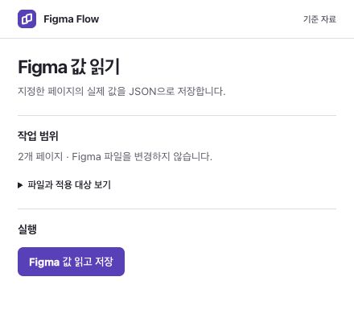
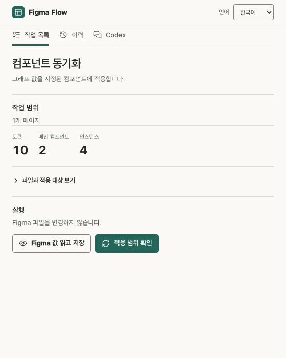
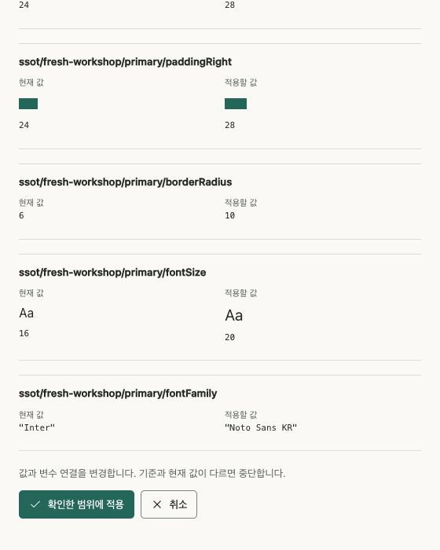

# Graph SSOT for a component

The graph owns token values once. Figma variables and generated web styles are projections. A pairing receipt pins native identities, alias topology, component consumers, baseline values and graph hash. Use the **0.24.0** tools with one registered Figma Flow workspace. Codex prepares project tasks under its stable manifest; upgrading Codex alone does not refresh an already running Figma task.

## Default: launch once, then use Codex local control

After workspace preparation, the user manually launches Figma Flow in the target Design file once per plugin session. Codex can then execute signed prepared operations without repeating panel clicks:

```sh
python3 tools/figma_control.py enable --workspace WORKSPACE --port 43180
python3 tools/figma_workspace.py refresh --workspace WORKSPACE
python3 tools/figma_control.py serve --workspace WORKSPACE
# Keep the local service running; issue commands from another Codex execution.
python3 tools/figma_control.py run --workspace WORKSPACE --key invite-discovery \
  --operation read --file-key FILE --page-id PAGE --expected-revision CURRENT_TASK_REVISION --timeout 120
```

For graph tasks, use `--operation read` or `--operation apply`; use the current `list` revision. `--focus-page` is allowed only for the task's exact signed file/page within the current file. Verify the returned `readback` artifact with normal native/web checks and pairing. An `ok` receipt is not design approval or independent origin authentication. Preserve `error`/`expired`/`uncertain` receipts, and re-read native state before retrying an uncertain write.

The plugin must remain open and the localhost service must be available. New `prepare`/`refresh` publishes metadata; automatic Desktop reloading is environment-dependent. Reopen the same stable plugin if it still runs an old revision. No hidden launcher or remote code evaluation is provided. The panel actions below remain the manual fallback. [Language, history and full setup](../../docs/guide.md#기본-흐름-한-번-실행하고-codex에-맡기기).

## Selected rich production and scoped native edits

A reviewed rich direction can enter selected production with its original artwork and layout. Prepare a `review` task with `--selection`, the separate `--layout`, `--product-graph` and `--change-request`. The layout schema is `figma-flow-authored-native-production-v1` with one candidate and exact `sourceSelection`; the change request schema is `figma-flow-selected-production-change-v1` with source hashes, the actual managed user directive and each authorized contrast/sync delta. Run `create`, then use `figma_draft.py verify-production --packet ARTIFACTS/packet.json --readback ACTUAL.json`. This is distinct from exploratory review and does not create a new approval. [Input contract and command example](../../docs/guide.md#selected-rich-production).

To exercise a real native-to-graph edit without Computer Use, prepare a separate `native-edit` task from `figma-flow-native-edit-plan-v1` JSON. The plan names the exact file/page and either 1–32 admitted node edits or one local variable/mode edit with actual `before` and proposed `after` values. Preparation has no native side effect; `apply` performs the admitted Figma API transaction. It is not arbitrary JavaScript, graph export or a human selection record.

```sh
python3 tools/figma_workspace.py prepare --workspace WORKSPACE \
  --key invite-native-edit --title "Invite native edit" --project "Invite" --kind native-edit -- \
  --plan ACTUAL_EDIT_PLAN.json
python3 tools/figma_control.py run --workspace WORKSPACE --key invite-native-edit \
  --operation apply --file-key FILE --page-id PAGE --expected-revision CURRENT_TASK_REVISION
```

Check the returned `native_edit.plan_sha256`, actual before/after values and `applied` state. Preserve rollback conflicts and uncertain receipts, re-read before retry, and keep the exact file/page/revision throughout. Import the real native result with the existing component-scope procedure below, then render and pair actual web evidence. Native mutation alone does not update the canonical graph or web. [Supported fields and plan example](../../docs/guide.md#prepared-native-edit).

Computer Use and official Figma MCP are not consumer dependencies. The user launches the registered plugin once per session; Codex uses its localhost commands. Manual panel actions and JSON transfer remain available when local control is unavailable.

## Minimal graph shape

```json
{
  "version": 1,
  "nodes": [],
  "edges": [],
  "design_system": {
    "version": 1,
    "id": "my-product",
    "tokens": {
      "button/size": {"type": "FLOAT", "value": 14},
      "button/inline": {"type": "FLOAT", "value": 16},
      "button/family": {"type": "STRING", "value": "Noto Sans KR"}
    },
    "components": {
      "invite-button": {
        "properties": {
          "fontSize": "button/size",
          "fontFamily": "button/family",
          "paddingLeft": "button/inline",
          "paddingRight": "button/inline"
        },
        "native": {
          "mainKeys": ["invite.component.Primary"],
          "instanceKeys": ["invite.screen.submit"]
        },
        "web": {"selector": "#invite-submit"}
      }
    }
  }
}
```

Use actual existing semantic keys or exact native IDs. Multiple declared pages require design_system.native.allowed_page_ids; Figma IDs belong to your project and private pairing data. Keys can use aliases instead of values. Referenced token types must agree. Existing graphs without design_system retain their existing tools.

## Discover and adopt

Run from the installed plugin root on a supported POSIX host (macOS/Linux). Windows-local workspace preparation is currently unsupported; retain the standalone compatibility route there. First initialize your private workspace once with your own Figma-issued manifest, and register only `WORKSPACE/manifest.json` in Figma Desktop:

```sh
python3 tools/figma_workspace.py init --workspace WORKSPACE --id-from OWN_MANIFEST.json
python3 tools/figma_workspace.py prepare --workspace WORKSPACE \
  --key invite-discovery --title "Invite native baseline" --project "Invite" --kind discover -- \
  --file-key FILE --page-id PAGE --include-page-id ADDITIONAL_INSTANCE_PAGE
```

`FILE`, page IDs and paths are placeholders for your actual scope. Codex supplies the originating `CODEX_THREAD_ID`; outside that session, optionally add the actual `prepare --thread-id UUID`. With neither, the task remains usable offline and chat connection is disabled; malformed explicit UUIDs are rejected. The arguments after `--` are generator flags only. `prepare` owns `--out`, `--plugin-id` and `--web-module`; do not override them.

Open **Figma Flow → 준비된 작업 → Invite native baseline → 열기**, then **Figma 값 읽고 저장**. Discovery reads only the declared pages and downloads `graph-native-discovery.json`. It does not create variables or apply values. Return with **작업 목록으로** after completion.

```sh
python3 tools/figma_workspace.py prepare --workspace WORKSPACE \
  --key invite-sync --title "Invite component sync" --project "Invite" --kind sync -- \
  --adopt --graph PROJECT/graph.json --native-readback ACTUAL_DISCOVERY.json
python3 tools/figma_workspace.py list --workspace WORKSPACE
```

Adoption creates graph-owned variables and rebinds only declared consumers. Every existing instance of a controlled main must be declared; unrelated shared variables stay unchanged. In **준비된 작업**, open the sync task. **적용 범위 확인** previews the changes; only **확인한 범위에 적용** writes them. Preserve the automatically downloaded actual focused getter.

`prepare` returns `artifacts` (the task output folder) and `web_module` (the generated module path); the native plan is `artifacts/native-plan.json`. Preserve these returned paths with the preparation result. Use those returned paths rather than guessing internal directories. Copy the module's exact bytes to the app-owned `PROJECT/web/graph-tokens.mjs`; reverse import later updates this app copy rather than workspace generation files. Incremental adoption also takes `--pairing PREVIOUS_RECEIPT`, admitting new fields/tokens while retaining existing owned identities.

The web imports the generated module. Render graphStylesheet in a style element, or consume muiComponents in MUI sx. Never pass raw numeric padding through MUI spacing conversion. Stamp graphSha256 in data-graph-sha on each mapped element. export writes web-probe.js; execute its read-only DOM probe through the authorized browser and save the actual result.

```sh
python3 tools/graph_sync.py pair --graph PROJECT/graph.json   --plan ACTUAL_PREPARED_NATIVE_PLAN.json --readback ACTUAL_NATIVE.json   --web-module PROJECT/web/graph-tokens.mjs --web-proof ACTUAL_WEB.json   --out PAIRING.json
```

A generated module's bytes alone cannot prove that the actual app consumed it.

## Manual panel controls and change preview

Keep the same private workspace ID and registered manifest. New tasks use new keys; changed tasks use their current `list` value `tasks[].revision` as `--replace-expected REVISION`. Close the running plugin and reopen the same Figma Flow to load the refreshed list. Transfer the complete workspace, including hidden `.generations`, when moving machines.

Private plugin data is ID-bound. Keep an original legacy plugin/ID when continuing its pages, or explicitly migrate from its actual readback. A foreign manifest or paired-state ID is not accepted as an ownership transfer. The workspace home opens only real prepared tasks; opening does not select a design or approve an apply.
| Panel | Controls and side effects |
|---|---|
| **Figma 값 읽기** (discovery) | **Figma 값 읽고 저장** reads only declared pages and downloads `graph-native-discovery.json`. It creates no variables and applies no graph values. |
| **컴포넌트 동기화** | **Figma 값 읽고 저장** reads current values. **적용 범위 확인** previews token changes, new tokens, binding repairs, mains and instances. Only **확인한 범위에 적용** starts writes. **취소** closes confirmation without applying; it cannot cancel an operation already started. |

Read/apply results download automatically. **JSON 다시 저장** retries the download without rerunning the operation. **실행 기록과 복구 정보** exposes diagnostics. On failure, preserve the latest JSON and any rollback conflicts, read the actual current state, and generate a fresh plan. A retained older success JSON is not evidence for the failed run, and a rollback report cannot be paired as success.







## Graph to Figma and web

Edit canonical values with load_graph/update_graph_values or the source editor. The prepared sync task resolves aliases and emits the next web module. Copy its exact returned module into the app, and retain the returned native plan for pairing. Apply in Figma performs exact scope/baseline checks and compensates its own partial writes; concurrent edits are preserved as conflicts.

```sh
python3 tools/figma_workspace.py prepare --workspace WORKSPACE \
  --key invite-sync --title "Invite component sync" --project "Invite" --kind sync \
  --replace-expected CURRENT_TASK_REVISION -- \
  --graph PROJECT/graph.json --pairing PAIRING.json
# Click “적용 범위 확인” → “확인한 범위에 적용”; save the actual getter.
# Run the actual web probe and pair the resulting current graph.
```

## Designer edits to graph

A variable edit imports normally. Direct component/instance edits require component-wide promotion with --node-edit-scope component. Preview records affected native instances and web selectors. Divergent direct edits or simultaneous edits to the same token are conflicts.

```sh
python3 tools/graph_sync.py import --graph PROJECT/graph.json --pairing PAIRING.json   --readback ACTUAL_DESIGNER_EDIT.json --node-edit-scope component   --web-module PROJECT/web/graph-tokens.mjs --out PREVIEW
python3 tools/graph_sync.py import --graph PROJECT/graph.json --pairing PAIRING.json   --readback ACTUAL_DESIGNER_EDIT.json --node-edit-scope component   --web-module PROJECT/web/graph-tokens.mjs --out ACCEPTED --apply
python3 tools/figma_workspace.py prepare --workspace WORKSPACE \
  --key invite-sync --title "Invite accepted repair" --project "Invite" --kind sync \
  --replace-expected CURRENT_TASK_REVISION -- \
  --graph PROJECT/graph.json --pairing PAIRING.json \
  --native-readback ACTUAL_DESIGNER_EDIT.json --import-report ACCEPTED/import-report.json
# Apply the accepted repair; actual native/web verification and pair finish the transaction.
```

The importer updates graph roots and derived foundations, then publishes the web module under the same graph lock. Interruption between file replacements leaves a recovery journal and never advances pairing.

```sh
python3 tools/graph_sync.py recover --recovery ACCEPTED/recovery.json
```

Supported design properties are fontFamily/fontSize, padding sides, backgroundColor/color/borderColor, borderWidth/borderRadius, gap, and supported width/height/minimum dimensions. Colors are opaque solid RGB. Normal/disabled variants can have separate graph components/selectors with nonoverlapping property scopes. Width/height require existing FIXED sizing; HUG uses minimum constraints. Complex structural/vector redesign, mixed paints and style-backed paints require explicit modeling/migration and are not silently inferred.

This route is an explicit export/read/import workflow. It does not run an unauthenticated background writer, and it does not create human selection or production design acceptance records.

## Standalone compatibility

Existing separately registered discovery/export plugins remain supported with `graph_sync.py discover` / `graph_sync.py export`, explicit `--plugin-id` and a fresh `--out`. Keep their original private-data identity. New work uses `figma_workspace.py prepare` and the stable workspace home. Neither route changes actual user-selection, native/web proof or pairing requirements.

When adopting uniform text linked to a local Figma style, the plugin derives a scoped style, preserves its other typography properties and variable bindings, and applies it to the declared labels. Instances can inherit the new style. Mixed runs or pre-existing style overrides require explicit inspection. If a write fails, rollback checks the original style ID, effective values and bindings for both mains and inherited labels.

## Contrast evidence

`contrast-unknown` is an inability to determine contrast, not a measured low ratio. The quality checker resolves SHA-pinned source images and supported gradients, composites the original layers and measures the minimum over all background pixels under the text bounds. Unsupported transforms or unresolved sources retain a reason and `min_ratio: null`. Do not add opaque backings by default to silence this warning. Preserve selected art, use authorized changes and keep actual native/browser evidence separate from the conservative authored-raster calculation.
