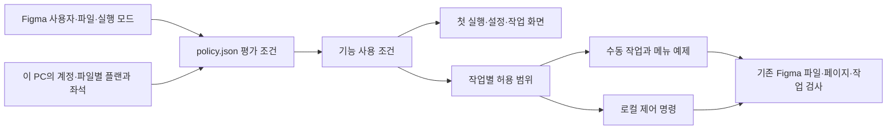

# Figma Design 첫 실행과 로컬 환경 설정

디자이너가 등록된 작업공간을 열면 Figma에서 확인한 계정과 실행 환경을 보고 현재 파일에 사용할 플랜·좌석 설정을 확인한다. 개발자는 같은 작업공간에서 파일 읽기와 인계 작업을 사용할 수 있다. [요구사항·화면·검사 연결](graph.json) · [실행 정책 그래프](../../library/figma-profile/policy.json) · [제품 범위](../../CONSTITUTION.md)

## 정보의 출처와 저장 위치

| 데이터 | 출처 | 용도 |
|---|---|---|
| 사용자 ID·이름 | Figma `currentUser` · manifest의 `currentuser` 권한 | 현재 사용자 표시, 계정별 설정 격리 |
| 파일 키·이름, 페이지 ID·이름 | 현재 열린 Design 파일과 페이지 | 팀별 좌석이 다른 계정에서도 해당 파일의 설정만 사용 |
| 편집기·모드·Plugin API 버전·플러그인 ID | 실행 중인 Figma Plugin API | 실제 실행 맥락 판정, 설치 구분 |
| 플러그인 버전·발행 세대·구현 해시·실행 명령·언어 | 등록된 런타임 및 패널 | 로컬 설정에 사용한 버전과 표시 언어 확인 |
| 플랜·좌석 | 사용자가 각각 지정하거나 ‘모름’으로 확인 | 제작 UI의 범위와 Dev Mode 인계 안내 선택 |
| 확인 시각·관측 시각·스키마 버전 | 로컬 실행 | 사용자 입력과 앱 관측을 구분하고 저장 레코드 식별 |

설정은 `figma.clientStorage`에 같은 플러그인 ID·사용자 ID·파일 키 단위로 남는다. 다른 PC·클라이언트나 캐시를 지운 환경에서는 최초 설정이 다시 나타날 수 있다. Figma의 사용자·파일 정보는 실행할 때 다시 읽고 달라진 관측을 갱신한다. 사용자 입력과 자동 관측은 각각 별도 키에 저장해 페이지를 읽는 작업이 좌석 선택을 덮어쓰지 않게 한다. 사용자나 파일을 식별할 수 없거나 로컬 저장소가 작동하지 않으면 현재 세션에서 설정을 사용한다. 첫 실행에 사용자 정보가 늦게 도착하면 짧게 다시 읽는다. 사용자가 바뀌거나 뒤늦게 계정이 식별되면 기존 익명 선택을 새 계정의 좌석으로 승격하지 않는다. 프로필을 정본 디자인 graph·캔버스·채팅·릴레이 이력으로 내보내지 않는다.

Figma가 공개한 User 객체에는 플랜, 청구 상태, 좌석과 파일 쓰기 권한 필드가 없다. Dev Mode Inspect에서 실행되는 사실은 그 파일의 현재 검사 맥락을 보여 준다. 그 사실만으로 Full과 Dev를 구별할 수 없다. 프로필 사진·협업 색상·세션 ID는 판정에 쓰지 않는다. [Figma User](https://developers.figma.com/docs/plugins/api/User/) · [Figma clientStorage](https://developers.figma.com/docs/plugins/api/figma-clientStorage/)

## 정본과 실행 경로

정책의 선택지, 평가 조건, 기능과 작업 관계는 `library/figma-profile/policy.json` 한 곳에 둔다. 공통 평가기가 각 기능의 선행 사실을 확인한다. UI에는 판정 결과를 전달한다. 웹 디자인의 토큰·컴포넌트 관계는 해당 프로젝트 graph가 계속 소유한다. 로컬 사용자 설정이 디자인 값을 변경하지 않는다.

- `designRead`는 읽을 수 있는 실행 맥락을 나타낸다. 쓰기 작업을 제한하는 프로필도 같은 파일에서 읽을 수 있다.
- `designEdit`는 Design/default에서 초기 설정을 확인했고 사용자가 읽기 전용 좌석을 지정하지 않았을 때 제작 요청을 표시·전달할 수 있다는 뜻이다. 실행 때는 기존 작업 승인과 Figma 파일 권한이 적용된다.
- `devHandoff`는 알려진 플랜·좌석이나 실제 Inspect 실행을 바탕으로 개발자 인계 안내를 표시한다.
- `devInspect`는 실제 `dev/inspect`에서만 활성화한다. Dev·Full 선택이 편집기 모드를 변경하거나 유료 기능을 부여할 수 없다.

기본 제작 플러그인은 Design 전용이다. 별도 ID의 로컬 Dev Mode 파일럿은 같은 정책 원본으로 검사 가능 여부를 계산한다. Figma는 플러그인 ID별로 로컬 저장소를 격리한다. 파일럿에는 사용자가 Design에서 설정한 좌석의 복사본을 두지 않으며, 실제 Dev Mode 실행 사실로 판정한다.

## 사용 예

| 현재 실행 맥락 | 로컬에서 확인한 값 | 표시할 기능 |
|---|---|---|
| Design/default | 모름으로 설정 완료 또는 Starter·좌석 모름 | 읽기와 제작 요청. 쓰기는 실제 파일 권한과 작업 범위를 확인한다. |
| Design/default | Professional·Dev | 파일 읽기와 개발자 인계 안내. 디자인 적용 동작은 숨긴다. |
| Design/default | Professional·Full | 읽기·제작 요청과 개발자 인계 안내. |
| Design/default | View 또는 Collab | 파일 읽기. |
| Dev/Inspect 파일럿 | 별도 좌석 선언 없음 | 실제로 열린 Inspect에서 선택한 레이어 읽기. |

## 인수 기준

| ID | 확인할 사용자 동작 |
|---|---|
| PROFILE-01 | 처음 열면 자동 계정·파일 맥락과 플랜·좌석 선택이 보인다. 모름으로도 확인할 수 있고 설정을 다시 열 수 있다. |
| PROFILE-02 | 같은 PC·계정·파일에서 다시 열면 선언을 복원한다. 다른 계정·파일에서는 이전 좌석을 물려받지 않는다. 저장 실패가 발생하면 세션 범위를 표시한다. |
| PROFILE-03 | 읽기 전용 설정에서 읽기는 제공하고 제작 동작은 UI·호스트·릴레이에서 제한한다. 잘못된 파일·페이지·세션에서 온 설정 요청은 저장하지 않는다. |
| PROFILE-04 | 임의의 플랜·좌석 선택으로 Dev/Inspect 맥락을 위조할 수 없다. 발행된 Design manifest, 로컬 저장, 정책 그래프, UI 빌드와 실제 Figma 홈을 각각 확인한다. |
